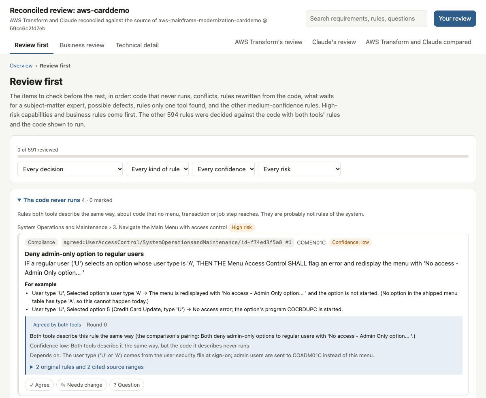
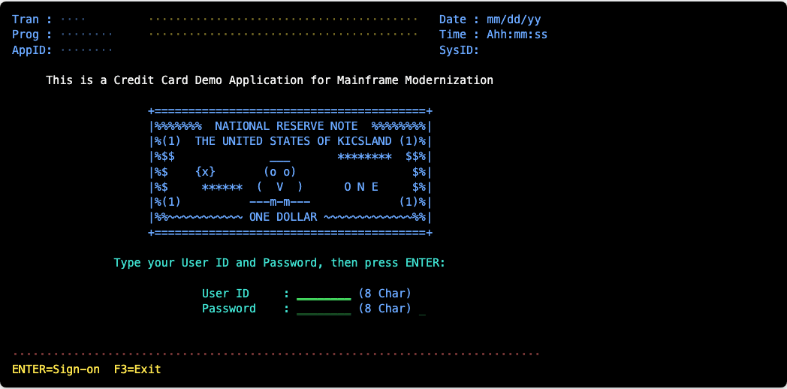
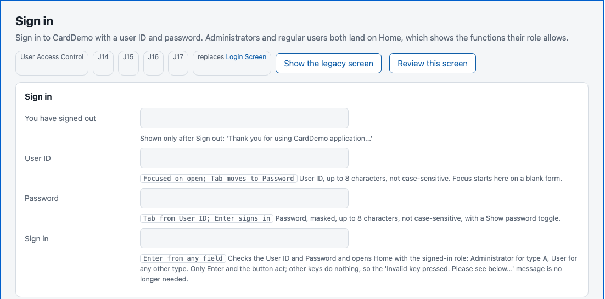
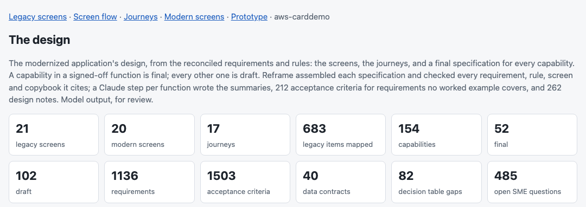
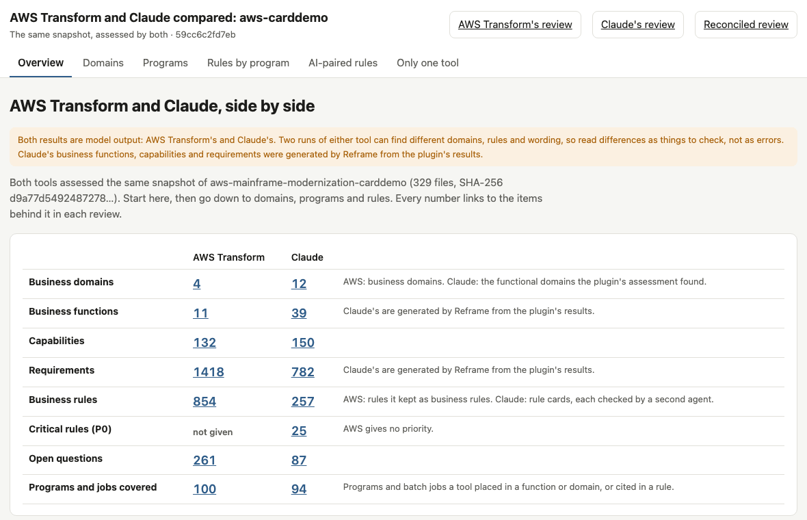

<p align="center">
  <picture>
    <source media="(prefers-color-scheme: dark)" srcset="docs/images/readme/logo-dark.svg" />
    
  </picture>
</p>

<h1 align="center">Reframe</h1>

<p align="center">
  <b>From legacy source to reviewed requirements, business rules and a design to build from.</b>
  <br />
  <sub>Tested end to end on mainframe COBOL and CICS. On other languages, Claude's assessment and the reconciliation should work, untested.</sub>
</p>

<p align="center">
  <a href="https://github.com/CodeStrata/reframe/actions/workflows/ci.yml"></a>
  <a href="https://github.com/CodeStrata/reframe/tags"></a>
  <a href="pyproject.toml"></a>
  <a href="LICENSE"></a>
  <a href="docs/pipeline-3.md#81-the-accuracy-audit-p3-11"></a>
  <a href="https://codestrata.github.io/reframe/"></a>
</p>

<p align="center">
  <a href="https://codestrata.github.io/reframe/"><b>Example output</b></a>
  &nbsp;·&nbsp;
  <a href="#quick-start">Quick start</a>
  &nbsp;·&nbsp;
  <a href="#how-it-works">How it works</a>
  &nbsp;·&nbsp;
  <a href="docs/guide.md">The guide</a>
  &nbsp;·&nbsp;
  <a href="CHANGELOG.md">Changelog</a>
  &nbsp;·&nbsp;
  <a href="CONTRIBUTING.md">Contributing</a>
</p>

<picture>
  <source media="(prefers-color-scheme: dark)" srcset="docs/images/readme/review-dark.png" />
  
</picture>

Reframe reads a legacy codebase and tells you, in plain words a business can review, what it does. It assesses the code with Claude's [code-modernization plugin](https://github.com/anthropics/claude-plugins-official/tree/main/plugins/code-modernization), and with AWS Transform as well if you have it, then checks every business rule against the source code itself. From that it designs the modern application, down to a package an AI coding tool can build from.

| Codebase | What runs | Tested |
|---|---|---|
| **Mainframe:** COBOL, JCL, CICS, BMS | Everything: Claude's assessment and AWS Transform's, the reconciliation against the code, the design and the package | **Yes**, end to end on AWS's CardDemo |
| **Other languages:** Java, .NET, PHP, Python, C and more | With Claude only, since AWS Transform writes requirements only for the mainframe. The assessment and the reconciliation should work: Claude's plugin reads any language. The design reads screens, flows and data definitions from mainframe sources only, so it stops on other codebases for now | **No.** Full support is planned ([the 1.1 specification](docs/any-legacy.md)) |

It is for modernization teams, architects and the business people who have to say "yes, that is what the system does" before anything is rebuilt.

## Why Reframe

- **Two assessments, one answer.** AWS Transform and Claude assess the same snapshot. Where they agree, the rule stands; where they don't, Claude decides against the source code, and Reframe checks that every line it cites exists.
- **Evidence, not opinion.** Every recommended rule cites the source lines behind it, with a confidence Reframe sets from what it checked, its kind, worked examples and any possible defect.
- **Measured.** On CardDemo, 51 of 56 sampled rules were judged correct (91%) by two independent model judges, with the disputes settled by a person. A [pack for a mainframe expert](docs/pipeline-3.md#813-a-mainframe-experts-own-check-sc-06) lets someone independent check the same sample.
- **Built to hand over.** Final specifications with acceptance criteria, data contracts and golden datasets, an AI-DLC package for Kiro, Claude Code or Spec Kit, and a backlog for Jira or Azure DevOps, every ID traced back to the legacy source.
- **People decide.** Reviewers mark *Agree*, *Needs change* or *Question*, answer the SME list and sign off by function; the next round redoes only what they touched.

## From green screen to a design

<table>
  <tr>
    <th width="50%">The legacy screen, drawn from its BMS source</th>
    <th width="50%">The modern screen Reframe designs from it</th>
  </tr>
  <tr>
    <td>
      <picture>
        <source media="(prefers-color-scheme: dark)" srcset="docs/images/readme/before-dark.png" />
        
      </picture>
    </td>
    <td>
      <picture>
        <source media="(prefers-color-scheme: dark)" srcset="docs/images/readme/after-dark.png" />
        
      </picture>
    </td>
  </tr>
</table>

Every legacy field, key and message is mapped to what replaces it, and the prototype shows each modern screen beside the one it replaces. The design page sums it up:

<picture>
  <source media="(prefers-color-scheme: dark)" srcset="docs/images/readme/design-dark.png" />
  
</picture>

**See what it makes before you run it:** the [example output for CardDemo](https://codestrata.github.io/reframe/carddemo/) (AWS's sample, 44 COBOL programs), from one run end to end: every review, the prototype, the design and the package, to click through. It is a showcase of the results, not a hosted service: Reframe runs on your own machine, on your own code. It is also in this repository: clone it and open `reports/carddemo/index.html`.

## What it makes

- **Business reviews:** domains, business functions, capabilities, requirements, business rules and open questions, from overview down to each rule. Reviewers mark *Agree*, *Needs change* or *Question* and send their marks back.
- **Rules checked against the code:** each recommended rule cites the source lines that back it. Each has a confidence Reframe sets from what it checked, a kind and worked examples. Possible defects are noted.
- **One SME list:** every question the code cannot settle, with the rules it holds up, to answer and feed back into the next round.
- **The design:** legacy screens and how they connect, user journeys, modern screens with every legacy field mapped, and a clickable prototype beside the legacy screens. A final specification for every capability, with acceptance criteria and data contracts.
- **An AI-DLC package:** the specifications in Kiro, Claude Code and Spec Kit form, with every ID traced back to the legacy source, a golden dataset per capability for equivalence tests, and a `START-HERE.md` for the team that builds it.
- **Exports:** the reconciled results as one Excel workbook, and the design as a backlog for Jira or Azure DevOps.

<details>
<summary><b>AWS Transform and Claude, side by side</b></summary>
<br />

<picture>
  <source media="(prefers-color-scheme: dark)" srcset="docs/images/readme/compare-dark.png" />
  
</picture>

Both tools assess the same snapshot. The comparison shows where they agree and where each found something the other did not; the reconciliation settles every difference against the code.

</details>

## How it works


| Step | Command | What happens |
|---|---|---|
| Assess | `reframe run` | One snapshot of the source is assessed by Claude's plugin, and by AWS Transform alongside it if you choose. Each gets a business review. |
| Reconcile | `reframe reconcile` | Claude checks every rule the tools don't describe the same way against the source code. Reframe checks that each cited line exists. Out come recommended rules, requirements and one SME list. |
| Design | `reframe design` | Journeys, modern screens, the prototype, final specifications, golden datasets and the AI-DLC package. A later round redoes only what new context touches. |
| Share (optional) | `reframe publish`, `reframe export` | A copy cleaned of your account's identifiers, to a folder, your AWS account or GitHub Pages; a workbook; a backlog. |

Every step is recorded before it starts and confirmed after it ends, so a run that stops (an expired sign-in, Claude's usage limit) continues with `reframe resume` without repeating work.

## Quick start

You need macOS or Linux (on Windows, WSL2), Python 3.10 or later and [uv](https://docs.astral.sh/uv/).

```bash
uv tool install "git+https://github.com/CodeStrata/reframe@v1.0.0"
```

### With Claude only

You need [Claude Code](https://docs.anthropic.com/en/docs/claude-code), signed in with your Claude subscription (or `--auth api-key` with an Anthropic API key, or `--auth bedrock`). You don't need an AWS account.

```bash
reframe setup --tools claude
```

```bash
reframe run --tools claude --source https://github.com/aws-samples/aws-mainframe-modernization-carddemo
```

```bash
reframe reconcile
```

```bash
reframe design --open
```

<details>
<summary><b>With AWS Transform as well</b></summary>
<br />

You also need an AWS account where AWS Transform is available, with an AWS CLI profile that signs in through IAM Identity Center. `reframe setup` checks the rest and offers to install it: the AWS CLI, Terraform and the AWS Transform MCP server.

```bash
reframe setup
```

```bash
reframe run
```

The guided run asks for the profile, the source (a folder, a ZIP file or a GitHub URL) and a project name, then runs both assessments in the background. `reframe status` says where a run is and what to do next. When both are done:

```bash
reframe compare --open
```

```bash
reframe reconcile
```

```bash
reframe design --open
```

```bash
reframe teardown
```

</details>

`reframe` on its own shows your runs, the suggested next step and a menu. Run every command from one folder, your workspace: each run lives in `.reframe/<project>/<run>/` there, with `inputs/` for the context you add and `outputs/` for what Reframe makes.

## Proof on CardDemo

| | On AWS's CardDemo (44 COBOL programs, 21 screens) |
|---|---|
| Recommended business rules | 1,185, each citing its source lines; 51 of 56 sampled judged correct ([the audit](docs/pipeline-3.md#81-the-accuracy-audit-p3-11)) |
| Requirements | 1,136, in 154 capabilities (52 signed off as final) |
| Acceptance criteria | 1,503 in Given/When/Then, from the rules' worked examples |
| Golden datasets | 1,595 cases the new system must answer as the old one does ([how](docs/pipeline-4.md#d10-golden-datasets-and-equivalence-tests-p4-11)) |
| The design | 20 modern screens for 21 legacy ones, 683 legacy items mapped, 17 journeys, 40 data contracts |
| The package | Kiro, Claude Code and Spec Kit forms, with every ID traced to the legacy source; every check passed |

Everything Reframe writes is model output for people to review, and the pages say so.

## What it takes

| Step | Time | At API prices, on CardDemo |
|---|---|---|
| Claude assessment | about 2 hours | the plugin's agents, on your Claude subscription, within an agent limit you set |
| AWS Transform assessment | about 1 hour, alongside Claude | AWS charges for the job and the run's resources, until `reframe teardown` |
| Reconciliation | 30 to 90 minutes | about $30 to $70 for a full round; a later round only what changed. With Claude only, every rule is checked: estimated $15 to $40 |
| Design | about 30 to 60 minutes | about $35 for a first round; a round that redoes every screen about $60 |
| Publish, package, export | seconds | none |

The figures are from live runs and are recorded in [docs/acceptance.md](docs/acceptance.md), [docs/pipeline-3.md](docs/pipeline-3.md) and [docs/pipeline-4.md](docs/pipeline-4.md).

## Documentation

| Read | For |
|---|---|
| [How to run Reframe](docs/how-to-run.md) | One page from install to handover |
| [The guide](docs/guide.md) | Every step in detail: the guided run, Claude only, results, reviews, the reconciliation, the design, sharing and teardown |
| [Commands](docs/cli.md) | Every command, option and example |
| Specifications | [The AWS Transform assessment](docs/specification.md), [the Claude assessment](docs/pipeline-2.md), [the reconciliation](docs/pipeline-3.md), [the design](docs/pipeline-4.md), [sharing](docs/sharing.md), [release 1.0](docs/release-1.md) |
| [The plan](docs/plan.md) | Every story, with what done means and the results |

## Roadmap

- **Beyond the mainframe (1.1):** any legacy codebase Claude's plugin reads (Java, .NET, PHP and more), with Claude only, and screens, flows and data contracts read for each stack ([the specification](docs/any-legacy.md)).
- **Proof at scale:** a codebase several times CardDemo's size, and a mainframe expert's own check of the audit.
- **Later:** a replacement order from the specifications, real legacy outputs under GnuCOBOL, and Claude on Amazon Bedrock, live ([docs/plan.md](docs/plan.md)).

## Contributing

Issues and pull requests are welcome. [CONTRIBUTING.md](CONTRIBUTING.md) says how to set up, run the offline tests and checks, and propose a change, and [SECURITY.md](SECURITY.md) how to report a problem privately. What has changed in each release is in [CHANGELOG.md](CHANGELOG.md).

## License

MIT. See [LICENSE](LICENSE).

The example reports describe AWS's [CardDemo](https://github.com/aws-samples/aws-mainframe-modernization-carddemo), under the Apache License 2.0; the extracts they quote stay AWS's ([notice](reports/carddemo/NOTICE.md)). Reframe is not made or endorsed by AWS or Anthropic.
