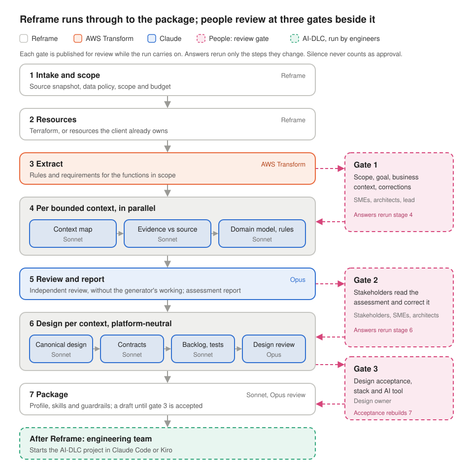

# Reframe

**From a mainframe repository to a traceable, AI-DLC-ready engineering handoff.**

Reframe reads a mainframe repository with AWS Transform. It checks AWS's findings against the pinned source with Claude, and has them reviewed independently. It then produces a platform-neutral design and a package that starts an AI-DLC project in Claude Code or Kiro. People review and correct it at three scheduled gates, and the run does not stop to wait for them.

**Reframe prepares a modernization project. It does not write the application, deploy anything or prove runtime equivalence with the mainframe.**

[](https://github.com/sknampally/reframe/actions/workflows/ci.yml?query=branch%3Av2)
[](v2/pyproject.toml)
[](LICENSE)
[](docs/v2/backlog.md)

> **Reframe is in development.** It cannot yet run an assessment from start to finish (see [Status](#status)). It is built from its [specification](docs/v2/specification.md).

## How it works



The run has seven stages, and none of them waits for a person:

- **Gates stay open beside the run.** At each gate, Reframe publishes the current version for review and carries on with it as a draft. An answer reruns only the steps it affects.
- **Exceptions park only what depends on them.** When nothing runnable is left, `status` shows WAITING_HUMAN or WAITING_EXTERNAL and what the project is waiting for.
- **Contexts run in parallel.** Stages 4 and 6 run once per bounded context.
- **Platform-neutral until gate 3.** Everything before gate 3 is independent of any stack. At gate 3 a named design owner accepts the design and chooses the stack and AI tool.
- **People make every decision.** Silence, a deadline or a model's confidence never counts as approval.

| Stage | Done by |
| --- | --- |
| 1 Intake and scope | Reframe: pins the source snapshot, records the data policy, scope and budget, estimates cost |
| 2 Resources | Terraform (`--provision`), or read-only checks of resources the client already owns (`--resources`) |
| 3 Extract | AWS Transform, for the functions in scope, through its MCP server |
| 4 Context map, evidence, domain model, rules | Claude Sonnet 5.5, per context, checking each claim against the pinned source |
| 5 Independent review and assessment report | Claude Opus 5.5, in a separate context without the generator's working |
| 6 Canonical design, contracts, backlog, tests | Claude Sonnet 5.5 per context, with an Opus 5.5 design review |
| 7 Profile, skills, guardrails and package | Claude from reviewed profile templates, an Opus 5.5 review, then Reframe's checks |

Workflow details are in [specification section 4](docs/v2/specification.md#4-workflow).

## Status

As of 19 November 2026. The [backlog](docs/v2/backlog.md) links every epic and story.

| Phase | What it proves | Status |
| --- | --- | --- |
| P0 Contracts | Schemas, state machine, ledger and budget, evidence and readiness, worker, data policy, provider interface, package manifest | Built and tested offline. The semantic fixtures (P0-14) wait for a person |
| P1 Prototype and external proof | The design site on three different samples; one authorized live AWS Transform path, from function selection to requirements retrieval | Intake and design site built. The live path waits for the owner's approval of its [execution envelope](docs/v2/envelopes/p1-live-path.md); the SME and architect reviews wait for people |
| P2 One domain | One CardDemo domain, from intake to package, on created and on client-owned resources | Offline parts built: state bucket, resources file, gate feedback, Terraform and bootstrap, Neptune graph |
| P3 Change and recovery | Resume, late context, failures, teardown, one slice on Bedrock | Not started |
| P4 Whole CardDemo | Every function at a pinned revision | Not started |
| P5 Scale | Two other public mainframe repositories, with nothing built for them | Not started |

Nothing has run against AWS yet. Every live step needs an execution envelope the owner approves first.

## Try what exists today

Reframe needs Python 3.11 or later. Install it in a virtual environment:

```bash
git clone --branch v2 https://github.com/sknampally/reframe.git
cd reframe
python -m venv .venv
source .venv/bin/activate
python -m pip install -e v2
reframe --help
```

These commands are available now. None of them changes anything in AWS:

| Command | What it does |
| --- | --- |
| `reframe bootstrap --print [--terraform <dir>]` | Prints the policy an administrator grants once; with `--terraform`, writes the Terraform module, a state-bucket definition and a resources-file template |
| `reframe graph --profile <aws-profile> --region <region> --bucket <name> [--use <cluster> \| --new] [--tfvars <file>]` | Lists the region's Neptune clusters read-only, says which can serve the reimagine connector and why the others cannot, and asks which to use by name or whether to create a new one |

The full command set, including `run`, `status`, `continue`, `accept` and `teardown`, is in [specification section 13](docs/v2/specification.md#13-commands). Each command arrives with the story that implements it.

## What a run will need

| Area | Supported |
| --- | --- |
| Source | COBOL, copybooks, BMS, JCL, CICS, VSAM, DB2 definitions, from a Git repository, local checkout or S3 ZIP |
| Extraction | AWS Transform for mainframe, through its MCP server |
| Model backend | Claude Sonnet 5.5 and Opus 5.5, through the Claude Code CLI for internal testing, or Amazon Bedrock in the customer's account for client work |
| Target | .NET and Blazor on AWS |
| AI tool for the team | Claude Code or Kiro |
| AI-DLC | awslabs/aidlc-workflows v2.11.4, pinned |
| Infrastructure | HashiCorp Terraform 1.10 or later, or client-owned resources |

Reframe is free to use. AWS Transform, Neptune, other AWS usage and Claude usage are paid prerequisites of every run. The full matrix is in [specification section 15](docs/v2/specification.md#initial-support-matrix).

## Documents

| Document | What it holds |
| --- | --- |
| [Specification](docs/v2/specification.md) | What Reframe does: the source of truth for every design and build decision |
| [Plan](docs/v2/plan.md) | Phases, success measures, risks and next steps |
| [Backlog](docs/v2/backlog.md) | The epics and stories in GitHub |
| [Envelopes](docs/v2/envelopes/) | What each live step may do, approved by the owner before it runs |
| [Evidence](docs/v2/evidence/) | Records of owner-authorized proofs |
| [Terraform](v2/src/reframe_v2/terraform/README.md) | The bootstrap policy, the modules and how the project composition is applied |

## Contributing

Changes follow one order: the [specification](docs/v2/specification.md), then the [plan](docs/v2/plan.md), then the epics and stories, and only then design and build ([change process](docs/v2/README.md)). Work uses feature branches from `v2` and pull requests back into `v2`. Each pull request names the specification sections and stories it implements, and CI checks that it does. Run the offline tests with `python -m unittest discover -s v2/tests`. [CONTRIBUTING.md](CONTRIBUTING.md) covers identity, review and publication.

## Author, security and license

Satish Kumar Nampally created Reframe. Reframe is [MIT licensed](LICENSE). [AWS CardDemo](https://github.com/aws-samples/aws-mainframe-modernization-carddemo) remains an independent sample under its own license.

Keep source assessments, account identifiers, credentials and client documents in private workspaces, **never in this public repository or its issues**. See [SECURITY.md](SECURITY.md) and [THIRD_PARTY.md](THIRD_PARTY.md).

Reframe is being developed with AI assistance. People are responsible for interpreting evidence, making decisions and validating any resulting application.
