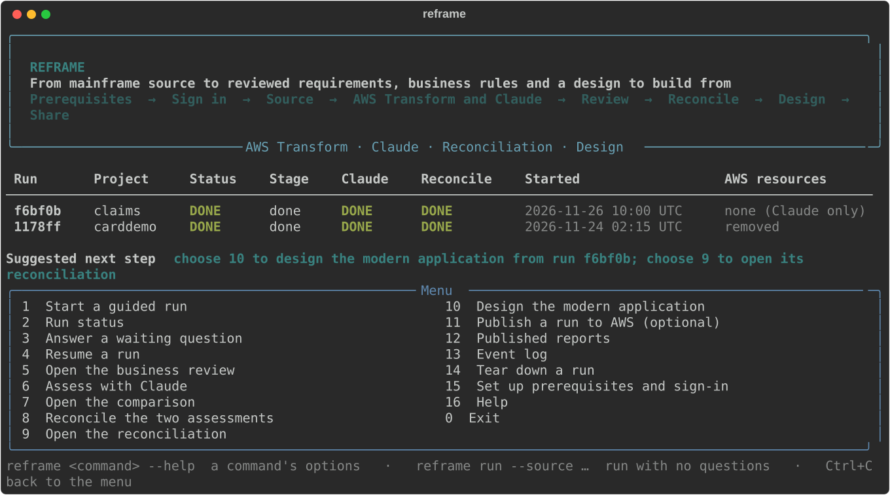
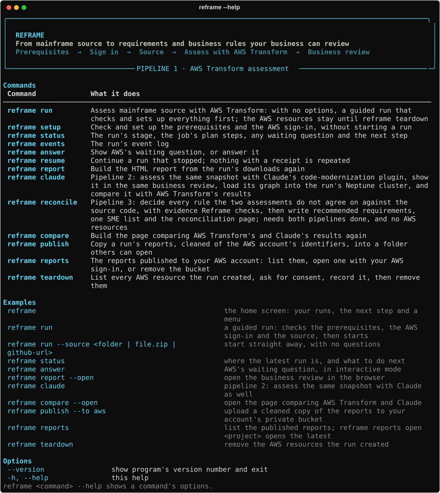

# Reframe command reference

Every command, its options and examples, as `reframe --help` and `reframe <command> --help` show them. [The guide](guide.md) explains what each pipeline does; this page is the list to keep open while you work.

## The home screen

`reframe` on its own shows your runs, the suggested next step and a numbered menu. Each menu entry runs one of the commands below; an action on a run asks which run, with the latest as the default. After each action the home screen comes back; `0` or Ctrl+D leaves it, and Ctrl+C cancels an action.



*The home screen with two example runs: a Claude-only run and a run with both tools, each reconciled.*

| # | Menu entry | Runs |
|---|---|---|
| 1 | Start a guided run | `reframe run` |
| 2 | Run status | `reframe status` |
| 3 | Answer a waiting question | `reframe answer` |
| 4 | Resume a run | `reframe resume` |
| 5 | Open the business review | `reframe report --open` |
| 6 | Assess with Claude | `reframe claude` |
| 7 | Open the comparison | `reframe compare --open` |
| 8 | Reconcile the two assessments | `reframe reconcile` |
| 9 | Open the reconciliation | `reframe reconcile --open` |
| 10 | Design the modern application | `reframe design --open` |
| 11 | Publish a run to AWS (optional) | `reframe publish --to aws` |
| 12 | Published reports | `reframe reports` |
| 13 | Event log | `reframe events` |
| 14 | Tear down a run | `reframe teardown` |
| 15 | Set up prerequisites and sign-in | `reframe setup` |
| 16 | Help | `reframe --help` |
| 0 | Exit | |

## `reframe --help`



## Claude only, start to finish

```bash
reframe setup --tools claude                         # Git, Claude Code and the plugin; no AWS
reframe run --tools claude --source <source>         # the snapshot and the Claude assessment, in the background
reframe status                                       # where the run is and what to do next
reframe report --open                                # Claude's business review
reframe reconcile                                    # every rule checked against the source code
reframe design --open                                # the design, the prototype and the AI-DLC package
reframe publish --to reports/<project>               # optional: a cleaned copy to share
```

## A full run with both tools, start to finish

The short version, with the folder layout, is [How to run Reframe](how-to-run.md). Run every command from your workspace folder: each run lives in its `.reframe/<project>/<run>/`.

```bash
aws sso login --profile my-profile        # sign in to AWS; Reframe never sees your credentials
reframe run                               # guided: prerequisites, sign-in, source, choices, then one yes
reframe status                            # where the run is and what to do next
reframe events --follow                   # every step as it happens, until Ctrl+C
reframe answer                            # only if a question waits for you (interactive mode)
reframe report --open                     # AWS Transform's business review
reframe claude                            # the Claude assessment, if you did not choose it in the guided run
reframe compare --open                    # AWS Transform and Claude compared
reframe reconcile --context <folder>      # the reconciliation: shows the estimate, and stops above the batch limit
reframe reconcile --max-batches <n>       # go ahead with the estimate it showed
reframe reconcile --open                  # the reconciliation page, opening with Review first
reframe review --context <folder>         # several reviewers' downloads: coverage, sign-offs, disagreements
reframe export --to xlsx                  # the reconciled results as one Excel workbook
reframe design --plan                     # the design: what a round would redo, with no Claude step
reframe design --open                     # run a design round, then open the design page
reframe design --package <empty folder>   # the AI-DLC package, cleaned, for the forward build
reframe publish --to aws                  # the run's source, results and reports in your account's private bucket
reframe reports open <project>           # open the project's latest published copy with your AWS sign-in
reframe teardown                          # remove the run's AWS resources, after you type yes
```

Every command acts on your latest run; add `--run <run id>` for another one. The home screen and `reframe status` show the run IDs.

**The guided run's questions**, in order:

1. Which AWS profile, and the region (default `us-east-1`).
2. Where the source is: a GitHub or Git URL (with a branch, tag or commit), a local folder or a ZIP file.
3. How AWS Transform's questions are answered: autonomous or interactive.
4. The project name, used in the run's folder and AWS resource names.
5. A new Neptune graph, or an existing cluster.
6. Whether to assess the same snapshot with Claude as well (the Claude assessment), how Claude signs in (your Claude subscription or Amazon Bedrock), and the agent limit for rule extraction.
7. A summary of what will be created, and one yes to start.

**The agent limit** is a ceiling, not a target: before rule extraction Reframe compares the plugin's upper estimate with it, and stops to ask if the estimate is higher. On CardDemo the estimate is 38 to 41 shards, up to about 615 agents, and a run uses about 430 to 480; a limit of 650 to 900 lets it go ahead without asking.

**The reconciliation** needs the run's assessments done (both, or Claude's on a Claude-only run) and no AWS resources, so it can run after `reframe teardown`. The context folder holds documents (Markdown, text, PDF, Word), review downloads (JSON or CSV) from any number of reviewers, with their sign-offs, and the SME list (`reconcile/questions.csv` in the run folder) with its `answer` column filled in. Run `reframe reconcile` again with more answers or marks and only the rules and functions they bear on are done again; a rule marked *Agree* is kept. If Claude's usage limit stops it, `reframe resume` continues. On CardDemo the estimate is 113 batches, 29 to 87 minutes, $56 to $130 at API prices; the acceptance run used about $67.

**Starting the Claude assessment later.** If your Claude usage limit is close, answer no to Claude in the guided run and run `reframe claude` once the limit resets. On a run whose AWS resources are still being created, it is recorded and starts as soon as they exist; on a run that is further along, it starts at once, alongside AWS Transform.

## Commands

### `reframe run`

Assess mainframe source with AWS Transform and Claude, or with Claude only (--tools claude, no AWS): with no options, a guided run that checks and sets up everything first; the AWS resources stay until reframe teardown.

| Option | What it does |
|---|---|
| `--source <source>` | the mainframe source: a local folder, a local .zip file, or a GitHub URL; given, nothing is asked and the prerequisites are assumed to be set up |
| `--profile <profile>` | the AWS CLI profile to sign in with (default: the one saved by the guided setup) |
| `--ref <ref>` | for a Git checkout or URL: the branch, tag or commit to assess (default: HEAD) |
| `--mode autonomous\|interactive` | autonomous: Reframe answers AWS and records why; interactive: answer each question with reframe answer |
| `--region <region>` | AWS region (default: the one saved by the guided setup, then us-east-1) |
| `--project <project>` | project name used in resource names (default: from the source's name) |
| `--graph <graph>` | new, existing (choose from a list) or the name of an existing Neptune cluster (default: interactive mode asks; autonomous mode creates a new graph) |
| `--terraform <terraform>` | the Terraform binary to use (default: REFRAME_TERRAFORM, then the one Reframe installed, then terraform on PATH) |
| `--foreground` | run in this terminal instead of a background worker |
| `--tools both\|claude\|aws` | both: AWS Transform and Claude, side by side (needs an AWS account); claude: Claude only, with no AWS at all; aws: AWS Transform only (reframe claude adds Claude later) |
| `--max-agents <max_agents>` | the agent limit for Claude's rule extraction (default 600; use 650 or more for CardDemo) |
| `--auth subscription\|api-key\|bedrock` | how Claude signs in: your Claude subscription (default), an Anthropic API key in ANTHROPIC_API_KEY, or Amazon Bedrock (with --tools claude, --profile and --region are used for Bedrock only) |

```bash
reframe run                                             # guided: asks for everything it needs
reframe run --source https://github.com/<owner>/<repo>  # a GitHub repository, latest commit
reframe run --tools claude --source app.zip             # Claude only, with no AWS: the assessment, then reframe reconcile and reframe design
reframe run --tools claude --auth api-key --source app.zip   # Claude only, billed to ANTHROPIC_API_KEY
reframe run --tools claude --auth bedrock --profile bedrock-dev --region us-west-2 --source app.zip   # Claude on Bedrock; no AWS resources
reframe run --source ~/code/app --ref release-1         # a local Git checkout, at a branch, tag or commit
reframe run --source app.zip --mode interactive         # a ZIP file; you answer AWS's questions with reframe answer
```

### `reframe setup`

Check and set up the prerequisites and the AWS sign-in, without starting a run.

| Option | What it does |
|---|---|
| `--tools both\|claude` | both: everything, with the AWS sign-in; claude: only Git, Claude Code and the plugin, with no AWS |

```bash
reframe setup                 # everything a run with both tools needs, and the AWS sign-in
reframe setup --tools claude  # only Git, Claude Code and the plugin, for a Claude-only run
```

### `reframe status`

The run's stage, the job's plan steps, any waiting question and the next step.

| Option | What it does |
|---|---|
| `--run <run>` | the run to act on (default: the latest run) |

```bash
reframe status             # the latest run
reframe status --run <id>  # another run, by the ID the home screen shows
```

### `reframe events`

The run's event log.

| Option | What it does |
|---|---|
| `--run <run>` | the run to act on (default: the latest run) |
| `--follow` | keep printing new events |

```bash
reframe events --follow  # keep printing new events until Ctrl+C
```

### `reframe answer`

Show AWS's waiting question, or answer it.

| Option | What it does |
|---|---|
| `--run <run>` | the run to act on (default: the latest run) |
| `<choices> ...` | option numbers as listed by reframe answer |
| `--text <text>` | a free-text answer, for a question without options |

```bash
reframe answer                        # show the waiting question and its numbered options
reframe answer 1 3                    # choose options 1 and 3
reframe answer --text "Yes, proceed"  # answer a question that has no options
```

### `reframe resume`

Continue a run that stopped; nothing with a receipt is repeated.

| Option | What it does |
|---|---|
| `--run <run>` | the run to act on (default: the latest run) |
| `--foreground` | run in this terminal instead of a background worker |

```bash
reframe resume  # continue the latest run, and its Claude assessment or reconciliation if they stopped too
```

### `reframe report`

Build the HTML report from the run's downloads again.

| Option | What it does |
|---|---|
| `--run <run>` | the run to act on (default: the latest run) |
| `--open` | open the report in the browser |

```bash
reframe report --open  # build the report again and open it
```

### `reframe claude`

The Claude assessment: assess the same snapshot with Claude's code-modernization plugin, show it in the same business review, load its graph into the run's Neptune cluster, and compare it with AWS Transform's results.

| Option | What it does |
|---|---|
| `--run <run>` | the run to act on (default: the latest run) |
| `--auth subscription\|api-key\|bedrock` | how Claude signs in: your Claude subscription (default), an Anthropic API key in ANTHROPIC_API_KEY, or Amazon Bedrock with the run's AWS profile or AWS_BEARER_TOKEN_BEDROCK |
| `--max-agents <max_agents>` | the agent limit for rule extraction (default: 600) |
| `--mode autonomous\|interactive` | default: the run's mode |
| `--graph-load yes\|no` | load Claude's graph into the cluster (default: yes on a graph the run created, no on an existing cluster) |
| `--foreground` | run in this terminal instead of a background worker |

```bash
reframe claude                   # start the Claude assessment on the latest run, now or as soon as its AWS resources exist
reframe claude --max-agents 650  # a higher agent limit, so a larger estimate does not stop to ask
```

### `reframe reconcile`

The reconciliation: decide every rule the two assessments do not agree on (with Claude only, every rule) against the source code, with evidence Reframe checks, then write recommended requirements, one SME list and the reconciliation page; needs the run's assessments done, and no AWS resources.

| Option | What it does |
|---|---|
| `--run <run>` | the run to act on (default: the latest run) |
| `--context <context>` | a folder of context: documents (Markdown, text, PDF, Word), review downloads (JSON or CSV, with sign-offs) and answered questions |
| `--auth subscription\|api-key\|bedrock` | how Claude signs in (default: as for the Claude assessment) |
| `--max-batches <max_batches>` | the limit for the decisions; Reframe stops and asks above it (default: 120) |
| `--foreground` | run in this terminal instead of a background worker |
| `--open` | open the reconciliation page instead of running |

```bash
reframe reconcile                               # reconcile the latest run: Reframe shows the estimate and stops above the batch limit
reframe reconcile --context ~/carddemo-context  # with documents, review exports and answered questions
reframe reconcile --max-batches 120             # go ahead with a larger estimate
reframe reconcile --open                        # open the reconciliation page
```

### `reframe review`

Read the review downloads in a folder and show each reviewer's coverage, sign-offs and where reviewers disagree; runs nothing, and the next reframe reconcile --context with the same folder combines them.

| Option | What it does |
|---|---|
| `--run <run>` | the run to act on (default: the latest run) |
| `--context <context>` | the folder holding the review downloads (JSON or CSV) |

```bash
reframe review --context ~/carddemo-context  # each reviewer's coverage, sign-offs and disagreements in the folder's review downloads
```

On CardDemo (25 November 2026) it read a JSON and a CSV download, showed each reviewer's sign-off and the one item they marked differently; the next round decided only that item's unit again. It writes `reconcile/reviews.json` in the run folder. A download of another snapshot, or a CSV downloaded before part 2 (without a `key` column), is listed as ignored with the reason.

### `reframe export`

Write a run's reconciled results as one Excel workbook: domains, functions, capabilities, requirements, business rules, decision tables, open questions and the SME list, with the reviewers' marks; runs nothing.

| Option | What it does |
|---|---|
| `--run <run>` | the run to act on (default: the latest run) |
| `--to xlsx` | the format: xlsx, an Excel workbook |
| `--out <out>` | the file or folder to write it to (default: outputs/reconcile/<project>-<run>-requirements.xlsx in the run folder) |
| `--context <context>` | a folder of review downloads whose marks to add (default: the reconciliation's context folder) |
| `--open` | open the workbook when written |

```bash
reframe export --to xlsx                               # the latest run's reconciled results as an Excel workbook in its run folder
reframe export --to xlsx --out ~/Desktop --open        # write it to a folder and open it
reframe export --to xlsx --context ~/carddemo-context  # with the reviewers' marks from the downloads in a folder
```

It opens on the Requirements sheet; every sheet has a frozen header row and filters. Requirements, business rules, capabilities and open questions carry **Mark** (every reviewer's marks combined, as the next round combines them), **Reviewers' marks** (each one, with the comment) and **Key**. Only downloads from the reconciled review of the same snapshot are read, from the run's own page or a published copy; the About sheet lists the files read and ignored. Every cell is text, never a formula, and cleaned as `reframe publish` cleans its copy; if anything is left, nothing is written. Reframe does not read the workbook back. See [sharing.md](sharing.md), section 7.

### `reframe design`

The design (pipeline 4): legacy and modern screens, journeys, the clickable prototype, final specifications and the AI-DLC package, from the reconciled results; a round redoes only what new context touches. See [pipeline-4.md](pipeline-4.md).

| Option | What it does |
|---|---|
| `--run <run>` | the run to act on (default: the latest run) |
| `--context <context>` | the design context folder (default: the one given before, then the run's `inputs/design/`) |
| `--stack <stack>` | the target stack, `"<front end>; <back end>; <data>"`; never chosen for you |
| `--plan` | say what a round would redo, and why, without a Claude step |
| `--package <folder>` | copy the latest package, cleaned, into an empty folder; runs nothing |
| `--form kiro\|claude-code\|spec-kit\|all` | with `--package`: which form (default: all) |
| `--check <copy>` | list the placeholders left in a copy of the package; runs nothing |
| `--open` | open the design page when done |
| `--auth subscription\|api-key\|bedrock` | how Claude signs in: subscription (default), api-key (ANTHROPIC_API_KEY) or bedrock |

```bash
reframe design                                    # a design round on the latest run: only what new context touches is redone
reframe design --plan                             # what a round would redo, and why, with no Claude step
reframe design --stack "React; Java 21 with Spring Boot; PostgreSQL"  # give the target stack: the data contracts get its types
reframe design --package ~/handover/app           # copy the AI-DLC package, cleaned, into an empty folder
reframe design --check ~/handover/app             # the placeholders still to fill in a copy of the package
reframe design --open                             # open the design page, with the prototype
```

A round runs in the foreground: the inventory and flow, the journeys, the modern screens, the prototype, the final specifications, the design page and the package. It writes `design/changes-<round>.md` and a new package version only when something changed. If Claude's usage limit stops it, run `reframe design` again: what is done is kept.

### `reframe compare`

Build the page comparing AWS Transform's and Claude's results again.

| Option | What it does |
|---|---|
| `--run <run>` | the run to act on (default: the latest run) |
| `--open` | open the page in the browser |

```bash
reframe compare --open  # build the comparison page again and open it
```

### `reframe publish`

Optional: copy a run's reports, cleaned of the AWS account's identifiers, into a folder others can open, upload the run's source, results and reports to your account's private bucket, or publish the copy to a GitHub Pages site. Nothing is copied, uploaded or published unless you run it.

| Option | What it does |
|---|---|
| `--run <run>` | the run to act on (default: the latest run) |
| `--to <to>` | a folder to write the copy into (for example reports/carddemo); aws to upload the run (source/, results/ and the cleaned reports/) to the private Reframe bucket in your AWS account; or pages to publish the copy to a GitHub Pages site, which is public, after you type yes |
| `--repo <repo>` | for --to pages: the GitHub repository, <owner>/<name>; the copy goes on its gh-pages branch |
| `--profile <profile>` | for --to aws: the AWS profile (default: the one saved by reframe setup) |
| `--region <region>` | for --to aws: the AWS region (default: the saved one, then us-east-1) |

```bash
reframe publish --to aws                # upload the run's source, results and reports to the private bucket in your AWS account
reframe publish --to reports/my-system  # write the copy into a folder
reframe publish --to pages --repo my-org/reports  # publish the copy to a public GitHub Pages site, after you type yes
```

### `reframe reports`

The reports published to your AWS account: list them, open one with your AWS sign-in, or remove the bucket.

| Option | What it does |
|---|---|
| `<action>` | list (the default): what is published; open: download one and open it; download: save one in a folder; teardown: remove the bucket |
| `<path>` | for open and download: a project (its latest run) or <project>/<run>, as reframe reports lists them |
| `--run <run>` | for open and download: an older run of the project |
| `--to <to>` | for download: the folder to save the report in |
| `--profile <profile>` | the AWS profile (default: the one saved by reframe setup) |
| `--region <region>` | the AWS region (default: the saved one, then us-east-1) |

```bash
reframe reports                                   # list the published reports
reframe reports open <project>                    # download the project's latest report with your AWS sign-in and open it
reframe reports open <project> --run <run>        # an older run of the project
reframe reports download <project> --to <folder>  # save the latest report in a folder, to keep or send on
reframe reports teardown                          # remove the bucket and every report in it, after your consent
```

### `reframe teardown`

List every AWS resource the run created, ask for consent, record it, then remove them.

| Option | What it does |
|---|---|
| `--run <run>` | the run to act on (default: the latest run) |

```bash
reframe teardown  # list the latest run's AWS resources, then remove them after you type yes
```

## Where things are

| Path | What it holds |
|---|---|
| `~/.reframe/config.json` | The saved profile, region and tool paths: the next run's defaults |
| `<workspace>/.reframe/<project>/<run>/` | A run, in the folder you run Reframe from: its state, event log, change records, Terraform roots, downloads, `inputs/` (the context you add) and `outputs/` (the reports, the reconciliation and the design) |
| `…/inputs/reconcile/`, `…/inputs/design/` | The context for the reconciliation and the design, read when `--context` is not given |
| `…/outputs/design/index.html` | The design page, with `prototype/` and `package/v<n>/` beside it |
| `…/outputs/report/index.html` | AWS Transform's business review |
| `…/outputs/claude/report/index.html` | Claude's business review |
| `…/outputs/comparison/index.html` | The comparison page |
| `~/.reframe/reports-store/` | The private reports bucket's Terraform state and records (on the computer that publishes), and `cache/` for reports opened with `reframe reports open` |

`reframe publish` builds one more page, the copy's `index.html`, which links the three reports above with the source, its commit and SHA-256. It exists only in a published copy: open it with `reframe reports open <project>`, or from the folder you gave to `--to`.

**On a Mac, publish outside Desktop, Documents and Downloads.** macOS keeps those folders private: a browser that has not been given access to one opens `index.html` but not the pages it links to. Reframe warns when you publish there. Use a folder such as `~/reframe-reports/<project>`, or give the browser access in System Settings > Privacy & Security > Files and Folders.
