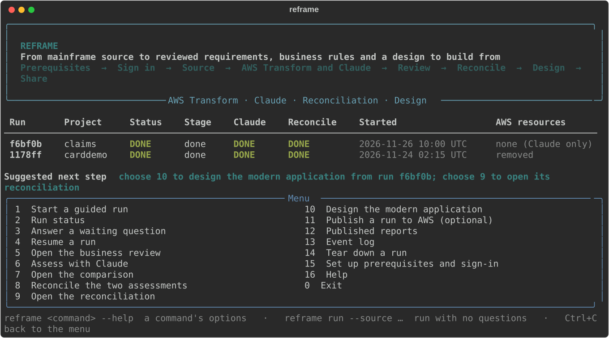

# The Reframe guide

Everything about running Reframe, step by step. Start with [How to run Reframe](how-to-run.md) for one page from install to handover; every command and option is in [cli.md](cli.md).

- [The home screen](#the-home-screen)
- [Run an assessment: the guided way](#run-an-assessment-the-guided-way)
- [Claude only, with no AWS](#claude-only-with-no-aws)
- [If a run stops](#if-a-run-stops)
- [Results](#results)
- [Reviewing the results with the business](#reviewing-the-results-with-the-business)
- [Removing the AWS resources](#removing-the-aws-resources)
- [The Claude assessment and the comparison](#the-claude-assessment-and-the-comparison)
- [The reconciliation](#the-reconciliation)
- [The design](#the-design)
- [Sharing the reports](#sharing-the-reports)
- [Code layout](#code-layout)

## The home screen

```bash
reframe
```

`reframe` on its own shows your runs (status, stage, Claude's status, the reconciliation's status, when each started, and whether its AWS resources are still in place), the suggested next step, and a numbered menu:



An action on a run asks which run, with the latest as the default. After each action the home screen comes back; 0 or Ctrl+D leaves it, and Ctrl+C cancels an action. `reframe --help`, and `--help` after any command, shows the commands or options as a table with examples.

### All the commands

| Command | What it does |
|---|---|
| `reframe` | The home screen above |
| `reframe run` | Start an assessment: guided with no options, or straight away with `--source` |
| `reframe setup` | Check and set up the prerequisites and the AWS sign-in, without starting a run |
| `reframe status` | The run's stage, the job's plan steps, any waiting question and the next step |
| `reframe events [--follow]` | The run's event log |
| `reframe answer` | Show AWS's waiting question, or answer it |
| `reframe resume` | Continue a run that stopped, whichever part stopped; nothing with a receipt is repeated |
| `reframe report [--open]` | Build AWS Transform's business review again |
| `reframe claude` | The Claude assessment: the same snapshot, assessed with Claude |
| `reframe reconcile [--context <folder>] [--open]` | The reconciliation: one recommended set from both assessments, decided against the source code |
| `reframe review --context <folder>` | Each reviewer's coverage, sign-offs and disagreements in a folder of review downloads |
| `reframe export --to xlsx [--out <file or folder>] [--open]` | The reconciled results as one Excel workbook, with the reviewers' marks |
| `reframe design [--context <folder>] [--stack "<stack>"] [--plan] [--open]` | The design: screens, journeys, the prototype, final specifications and the AI-DLC package; a round redoes only what new context touches |
| `reframe design --package <folder> \| --check <copy>` | Copy the package, cleaned, into an empty folder; list the placeholders left in a copy |
| `reframe compare [--open]` | Build the comparison page again |
| `reframe publish --to <folder or aws>` | A copy of the reports, cleaned of your account's identifiers |
| `reframe reports [open \| download <project> \| teardown]` | The reports published to your AWS account: list, open or save one by project, or remove the bucket |
| `reframe teardown` | List the run's AWS resources, ask for your consent, then remove them |

Every option and example, with the full `reframe --help` screen, is in [docs/cli.md](cli.md).

## Run an assessment: the guided way

```bash
reframe run
```

Reframe guides you through five steps and checks each answer before going on:

1. **Prerequisites.** A table of what a run needs and what this computer has: Git, the AWS CLI v2, uv, Terraform 1.10 or later and the AWS Transform MCP server (Claude Code is listed as optional, for the Claude assessment). For anything missing it shows the install command for your operating system and offers to run it; nothing is installed without your yes. Reframe installs Terraform itself: the pinned HashiCorp release, checked against HashiCorp's SHA-256 sums, kept in `~/.reframe/tools` and used from there, so your PATH, your shell files and any older Terraform stay as they are.
2. **AWS sign-in.** Choose one of your AWS CLI profiles and the region. If the profile is not signed in, Reframe offers to run `aws sso login` for you; you sign in in your browser, and Reframe never sees your credentials. With no profiles, it offers `aws configure sso`.
3. **Source.** A GitHub or Git URL (checked with Git, and optionally a branch, tag or commit), a local folder, or a local ZIP file.
4. **Choices.** Autonomous or interactive (see below), the project name (a short label such as `carddemo`: it names the run's folder, `.reframe/<project>/<run>/` in your workspace, and starts the name of every AWS resource the run creates, `reframe-<project>-<run>`), a new Neptune graph or an existing cluster, and whether to assess the same snapshot with Claude as well (the Claude assessment; see below), with how Claude signs in and the agent limit for rule extraction.
5. **Summary.** What will be created, then one yes to start. The run continues in the background.

Your profile, region and tool paths are saved in `~/.reframe/config.json` as the next run's defaults. To check the prerequisites and sign in without starting a run:

```bash
reframe setup
```

### Follow the run

```bash
reframe status
```

```bash
reframe events --follow
```

`reframe status` shows the stage, the AWS Transform job's plan steps, any question waiting for you and what to do next. Every command acts on your latest run; add `--run <run id>` for another one. The run ID is printed when the run starts.

Open the report when the run is done:

```bash
reframe report --open
```

### Run without questions

When the prerequisites are set up (for example after `reframe setup`, or on a build machine), give the source and Reframe asks nothing. The profile and region default to the ones you saved:

```bash
reframe run --source https://github.com/aws-samples/aws-mainframe-modernization-carddemo
```

```bash
reframe run --source ~/code/my-mainframe-app --profile my-profile --mode interactive
```

```bash
reframe run --source ~/Downloads/my-mainframe-app.zip --project my-app
```

Add `--ref <branch, tag or commit>` for a Git source, `--region` for another region, `--graph new|existing|<cluster name>` for the Neptune choice, and `--terraform /path/to/terraform` (or `REFRAME_TERRAFORM`) for a Terraform of your own.

### Autonomous or interactive

Autonomous is the default: Reframe answers AWS on your behalf and writes each answer and its reason to the run's `decisions.json`. It chooses "Assess and reimagine", gives the uploaded source's location, and selects every business domain plus the unassigned programs, so the whole source is assessed.

To make the choices yourself, add `--mode interactive`:

```bash
reframe run --source ~/code/my-mainframe-app --profile my-profile --mode interactive
```

When AWS asks something, `reframe status` says so. See the question and its numbered options:

```bash
reframe answer
```

Answer with the option numbers (several for the catalog, such as `reframe answer 2 3`), or in your own words:

```bash
reframe answer 1
```

```bash
reframe answer --text "Reimagine business domain \"Payments\""
```

The worker sends your answer within a minute. In autonomous mode, a question Reframe does not recognise also waits for `reframe answer`.

### Neptune: a new graph or an existing cluster

By default each run creates its own Neptune Serverless graph in a private network with no internet access. It bills until you run `reframe teardown`.

To use a Neptune cluster you already have, pass `--graph existing` to choose from a list, or `--graph <cluster name>`. With no `--graph`, interactive mode lists the clusters in the region and asks. Reframe uses an existing cluster as it is and never changes or deletes it. It offers one only if it meets every need: available with an instance, Serverless, engine 1.4.5.1 or later, IAM authentication, encryption, subnets in two availability zones with an S3 gateway endpoint, a security group pair, and a bulk-loader role that can read the run's source bucket. For each cluster it rejects, it says why.

## Claude only, with no AWS

No AWS account, or no AWS Transform? Run Reframe with Claude only ([release 1.0](release-1.md), section 2). It needs Git, [Claude Code](https://docs.anthropic.com/en/docs/claude-code) signed in with your Claude subscription, and the code-modernization plugin, which Reframe fetches itself.

```bash
reframe setup --tools claude
```

```bash
reframe run --tools claude --source https://github.com/aws-samples/aws-mainframe-modernization-carddemo
```

The guided `reframe run` asks the same thing first: *AWS Transform and Claude, or Claude only?* A Claude-only run:

- takes the snapshot into the run folder and creates nothing outside your computer, so there is nothing to tear down;
- runs the Claude assessment (the plugin's steps, then Reframe's requirements) and builds Claude's business review; Claude's graph stays a file, `outputs/claude/graph.nq`, since there is no Neptune;
- reconciles by checking **every** Claude rule against the source code (kept, rejected or sent to an SME), in Claude's own domains and functions, because there is no second tool to agree with; on CardDemo that is about 35 batches, $15 to $40 at API prices;
- then designs and publishes exactly as a run with both tools does.

`reframe compare` says there is nothing to compare, and `reframe teardown` that there is nothing to remove.

## If a run stops

`reframe status` names what happened and the next step. The usual cases:

| Status | What to do |
|---|---|
| `WAITING_SIGNIN` | Your AWS sign-in expired. Run `aws sso login --profile my-profile`, then `reframe resume`. |
| `WAITING_HUMAN` | AWS is waiting for an answer: run `reframe answer`, then answer it. |
| `UNCERTAIN` | A change was sent but its result is unknown. `reframe resume` checks AWS's state before doing anything again. |
| `FAILED` or `REFUSED` | Read the message and `worker.log` in the run folder, fix what it says, then `reframe resume`. |

`reframe resume` continues from where the run stopped. Nothing with a receipt is done again.

## Results

**Run Reframe from your workspace folder.** Everything for a run is there, in `.reframe/<project>/<run id>/`, one folder per project and one per run. Reframe's own tools and settings stay in `~/.reframe`. Keep `.reframe/` out of Git: run folders hold your account's identifiers. Share `reframe publish`'s cleaned copy instead.

| Path | What it holds |
|---|---|
| `inputs/reconcile/` | What you add for the reconciliation: documents, review downloads, the answered SME list. Read when `--context` is not given. |
| `inputs/design/` | What you add for the design: `personas.md`, `decisions.md`, `target-architecture.md`, `design-system/`, `style-reference/`, the prototype's and the reconciliation page's review downloads. |
| `outputs/` | Everything Reframe makes for people to read: the reports below, `reconcile/`, and `design/` (the design page, the prototype, the package). |
| `outputs/report/index.html` | The business review report. Rebuild it with `reframe report`. |
| `outputs/requirements/` | AWS's requirements per business function, with `traceability.yaml` linking rules to requirements. |
| `outputs/aws/` | AWS's assessment results. |
| `outputs/catalog/` | The business function catalog (`delivery.zip`, unpacked). |
| `decisions.json` | Every answer Reframe gave on your behalf, and why. |
| `events.jsonl` | The run's event log. |
| `changes/` | The record of every change Reframe made in AWS: what it meant to do, and AWS's receipt. |
| `worker.log` | The background worker's output. |

## Reviewing the results with the business

`reframe report --open` opens the business review report. It is one HTML file with everything inside it, so you can send it to business users and functional subject-matter experts as it is; they need only a browser.

- **It starts at the top:** what was assessed and the business domains. From a domain they go to its business functions, from a function to its capabilities (AWS's user stories), and from a capability to each requirement in plain words, with the business rules behind it and AWS's open questions for the business. A breadcrumb leads back up, and the search box finds any requirement, rule or question.
- **They mark what they read:** Agree, Needs change or Question on each requirement, business rule and open question, with a comment. Progress shows on every domain, function and capability. Marks stay in their browser.
- **They send their review back:** under **Your review** they enter their name and download their marks as a CSV file (for a spreadsheet) or a JSON file. Each row names the domain, function, capability, item, mark and comment, and the file names the run and the source's SHA-256, so a review always matches the code that was assessed.
- **Technical detail** (all requirements and rules in tables, the data model, the assessment, AWS's own pages and Reframe's answers) is in its own section, for engineers.

## Removing the AWS resources

```bash
reframe teardown
```

Teardown runs in your terminal and asks before it deletes anything:

1. It lists every AWS resource the run created, taken only from the run's own records: the AWS Transform job, workspace and connector from their creation receipts, and everything in the run's Terraform state. Nothing is found by name.
2. You type `yes` to delete them all. Anything else keeps them. Your consent, with the list and its hash, is saved in `teardown/consents.json`.
3. It deletes in order: the job, the workspace, the connector, any network interface AWS Transform left in the run's own network, the project resources, then the state bucket. With a new Neptune graph this takes about 15 minutes.
4. It checks every resource tagged with the run and reports anything still in AWS.

Two things you may see at the end:

- The AWS Transform connector may be left over. Some roles are not allowed to call DeleteConnector, and AWS often removes the connector itself a little later. Its IAM role is deleted, so it can reach nothing.
- AWS's tag index can list deleted resources for a while. Reframe checks each one in its own service and reports only what still exists.

If the list changes between your `yes` and the deletion, Reframe stops and asks again. An existing Neptune cluster you chose is never in the list.

## The Claude assessment and the comparison

The guided `reframe run` offers the Claude assessment, with yes as the default. It runs alongside the AWS Transform assessment in a worker of its own: it starts as soon as the run's AWS resources exist (about ten minutes in), while AWS Transform is still working, and its comparison waits for AWS Transform's results. To add it to a run you already have, or to start it later (for example once your Claude usage limit resets):

```bash
reframe claude
```

| Stage | What happens |
|---|---|
| C0. Preflight | Checks Claude Code and its sign-in, Python 3, and the code-modernization plugin. Reframe fetches the plugin itself, at one pinned commit of Anthropic's plugin repository, and loads it only for its own runs. Nothing is installed into your Claude Code settings. |
| C1. Workspace | The run's snapshot is unpacked read-only in the run folder, after its SHA-256 is checked against the one AWS Transform assessed. Nothing of AWS Transform's results is in it. |
| C2-C4. The plugin's steps | `preflight`, `assess`, `map` and `extract-rules`, each run headless with `claude -p`. Before rule extraction Reframe shows the plugin's estimate (on CardDemo, 38 to 41 shards: up to about 615 agents and 9 million tokens, about an hour; a run uses about 430 to 480 agents) and goes ahead only within your agent limit. |
| C5. Retrieval | The plugin's files are kept as written and read into the report: the assessment, the map, the rule cards and the open questions. The snapshot is checked again, to prove nothing changed. |
| C6. Requirements | Claude's plugin writes rule cards, not requirements. Reframe asks Claude, one domain at a time, to write requirements in AWS Transform's shape from those rule cards. Each one must cite a rule card or a source line that exists, and each is labelled **generated by Reframe from Claude's results**. |
| C7. Graph | Claude's map and rules go into the run's Neptune cluster as their own named graph, beside AWS Transform's, through a small loader function in the run's private network. |
| C8. Reports | Claude's business review, in the same layout as AWS Transform's, and the comparison page. |

Options:

- `--auth subscription` (the default) signs Claude in with your Claude subscription. `--auth bedrock` uses Amazon Bedrock with the run's AWS profile, or a Bedrock API key in `AWS_BEARER_TOKEN_BEDROCK`.
- `--max-agents` sets the agent limit for rule extraction (default 600). It is a ceiling, not a target: Reframe stops and asks only if the estimate is higher. For CardDemo use 650 or more, so the run does not stop to ask.
- `--graph-load yes` loads Claude's graph into an existing Neptune cluster. A graph the run created is loaded by default.
- If Claude's usage limit is reached, the run stops and says so. When the limit resets, `reframe resume` continues where it stopped, and runs extraction again for any modules the plugin did not finish.

```bash
reframe compare --open
```

This opens the comparison page. It starts with the numbers side by side, then goes down:

- **Domains:** each AWS domain with the Claude domains that hold the same programs.
- **Programs:** each program, and which tool covered it.
- **Rules by program:** the two tools' rules about the same program, side by side.
- **AI-paired rules:** pairs proposed by Claude, labelled as AI output, each with a reason and a confidence. You mark each pair Right or Wrong.
- **Only one tool:** what only one tool found.

Both results are model output, and the page says so.

`reframe teardown` also removes the Claude assessment's graph loader function. It waits until AWS has released the function's network interfaces, about 20 minutes, before it deletes the network.

## The reconciliation

When both assessments are done, `reframe reconcile` turns the two assessments into one recommended set, deciding against the source code whatever the two tools do not describe the same way ([docs/pipeline-3.md](pipeline-3.md)). It needs no AWS resources, so it works after `reframe teardown`, and it runs on your Claude sign-in, as the Claude assessment does.

```bash
reframe reconcile --context ~/carddemo-context   # gathers everything, shows the estimate, and stops above the batch limit
reframe reconcile --max-batches 113              # go ahead with the estimate it showed
reframe status                                   # progress, the decisions, the SME list and the requirements
reframe reconcile --open                         # the reconciliation page
```

**Your context folder** is optional and holds three kinds of file, read by kind:

- **Documents:** Markdown, text, PDF or Word, for example a glossary or a process description. They are given to every decision.
- **Review downloads:** the JSON or CSV files you download from any review page (*Your review*), from as many reviewers as you like. A *Needs change* or *Question* mark sends its rule to an agent with your comment, or, on a requirement or capability, has its function's requirements written again. An *Agree* on a recommended rule keeps it as it is in later rounds. Sign-offs of whole functions are read too. A download of another snapshot is ignored and reported.
- **Answered questions:** the SME list with its `answer` column filled in, as CSV or JSON.

**What it does:**

1. Rules both tools describe the same way are agreed without an agent deciding them. A step reads their code to say whether it runs, what kind of rule each is, and to give worked examples.
2. Every other rule is decided by a headless Claude step that reads the source code: overlapping and conflicting rules merged into the rules the code supports, rules only one tool found kept or rejected, rules about code that never runs rejected, and what the code cannot settle turned into a question. Reframe checks every answer: each cited line exists in the snapshot, the lines showing how the code is reached exist, and every input rule is covered. A failed answer is asked once more, then becomes a question.
3. Each recommended rule gets a **confidence Reframe sets** from what it checked (high only when an agent decided it with both tools' rules and the code is shown to run), a **kind** (business, validation, compliance, error handling, display, technical, side effect or leftover) and one to three **worked examples** whose quoted values Reframe finds in the cited code. A possible defect is noted once per decision, called unintended or deliberate, with the lines that show it.
4. Both tools' open questions and its own are merged into **one SME list**, `reconcile/questions.csv` in the run folder, with the possible defects found in the code.
5. **Recommended requirements** are written from the recommended rules, in AWS Transform's domains and business functions, with **decision tables** where rules share conditions (gaps listed for an SME) and a **risk level** per capability that Reframe sets from what it touches: money, security or audit make it high, card or personal data or record updates medium.
6. The **reconciliation page** opens with **Review first**: code that never runs, conflicts, rewritten rules, open questions, unintended defects, rules only one tool found and the other medium-confidence rules, high-risk capabilities first. Each recommended rule shows how it was decided, both tools' originals side by side, the cited source lines and how the code is reached. The other three pages link to it, and `reframe publish` includes it as `reconciled/`.

**Running it again.** Fill in the SME list's `answer` column, put the file in your context folder, and run `reframe reconcile` again. Only the rules an answer or a review mark bears on are decided again; the rest keep their decisions, and the page shows which round decided each rule.

**Several reviewers.** Each reviewer marks a review page and downloads their marks (JSON or CSV), and can sign off whole functions. Put every download in the context folder and check them first:

```bash
reframe review --context ~/carddemo-context      # each reviewer's coverage and sign-offs, and where reviewers disagree
reframe reconcile --context ~/carddemo-context   # the next round combines them: Needs change and Question over Agree
```

`reframe status` shows which functions are signed off, by whom and when; pipeline 4 takes signed-off functions as final.

**In a spreadsheet.** `reframe export --to xlsx` writes the reconciliation as one Excel workbook: a sheet each for domains, business functions, capabilities, requirements (with the business rules, programs and source lines behind each), business rules (with decision, confidence, evidence and worked examples), decision tables with their gaps, open questions and the SME list. With a context folder it adds each reviewer's mark and comment, and the sign-offs. Every cell is text, cleaned as `reframe publish` cleans its copy. Reframe does not read the workbook back: answers still go in the SME list CSV and marks in the review downloads.

```bash
reframe export --to xlsx --context ~/carddemo-context --open
```

On GenApp (run 8e5a08, 25 November 2026) it wrote 417 requirements, 446 business rules, 224 decision table rows and 190 SME questions in under two seconds.

**On CardDemo** (run fa1f61, 24 November 2026), the estimate was 113 batches, 29 to 87 minutes and $56 to $130 at API prices. The run used about $67 at API prices. It decided 431 units with evidence that all exists in the snapshot and covered all 1,111 input rules. It wrote 1,204 recommended rules, 1,153 requirements and an SME list of 313 questions (from 349) with 187 possible defects. Run again with one more answered question, it decided 5 units again in 2 batches and kept 426. On the Claude subscription a full run can reach the five-hour usage limit; it stops with the reason, and `reframe resume` continues where it stopped.

**Part 2 on CardDemo** (25 November 2026). Round 3 decided all 431 units again in about 52 minutes and $32 at API prices: 1,185 recommended rules with Reframe's confidence (718 high, 463 medium, 4 low), a kind and worked examples, 1,131 requirements with 114 decision tables, and 182 possible defects shown once each. An audit of a new sample found no rule wrong by both judges and 56 of 65 correct, with 6 for the owner to settle, and every rule with an error rated medium. Two reviewers' files, one JSON and one CSV with a disagreement and two sign-offs, went through `reframe review`, and round 4 decided 1 unit again and wrote one function's requirements again. The figures are in [docs/pipeline-3.md](pipeline-3.md), section 8.12.

## The design

When the reconciliation is done, `reframe design` designs the modernized application from it ([docs/pipeline-4.md](pipeline-4.md)). It needs no AWS resources and runs on your Claude sign-in.

```bash
reframe design --plan        # what a round would redo, and why, with no Claude step
reframe design --open        # run a round, then open the design page
```

A round runs every stage in order and keeps what has not changed:

| Stage | What it makes | Claude |
|---|---|---|
| Screen inventory and flow | Every BMS map read into its fields and keys, drawn as a 3270 copy; how the screens and programs connect, each link citing its lines | No |
| Journeys | The tasks people do, from where they start to where they finish, each with its capabilities and requirements | One step per domain |
| Modern screens | Screens from Reframe's design system (or yours), and a mapping that takes every legacy screen, field and key to what replaces it, with the reason | One step per domain |
| Prototype | One offline page: a route per screen, sample data, the rules' own messages, each screen beside the legacy screens it replaces, and marks reviewers can download | No |
| Final specifications | Per capability: requirements, business rules (classed), acceptance criteria, screens, data contracts from the copybooks, decision tables with gaps, open questions; final where the function is signed off | One step per function, for summaries, criteria and design notes |
| The package | Kiro, Claude Code and Spec Kit forms, every ID traced back to the legacy source, with `[FILL IN: ...]` placeholders for what your team gives and a `START-HERE.md` | No |

**Adding context.** Put it in the run's `inputs/design/`, or pass `--context <folder>` once, and run `reframe design` again:
- `personas.md` reaches the journeys;
- a decision in `decisions.md` reaches only the parts it names;
- a prototype download's *Needs change* reaches the domain that designed the screen;
- a sign-off from the reconciliation page makes its function final, with no Claude step.

Each round writes `design/changes-<round>.md`: what was redone and why, and what was kept. The package gets a new version, with its `CHANGES.md`.

**The target stack** is yours to give; Reframe never chooses one. `reframe design --stack "React with TypeScript; Java 21 with Spring Boot; PostgreSQL"` adds the stack's code and column types to the data contracts, with no Claude step.

**Handing over.** `reframe design --package ~/handover/<project>` copies the package, cleaned, into an empty folder. `START-HERE.md` there says what to fill in and how to prove it by building *Sign in*; `reframe design --check ~/handover/<project>` lists what is left.

**On CardDemo** (run fa1f61, 25 and 26 November 2026), the design cost about $35 at API prices:
- 21 legacy screens, 20 journeys, and 20 modern screens with all 683 legacy items mapped;
- a 19-screen prototype;
- 154 specifications (52 final) with 1,505 acceptance criteria;
- a package of 1,113 files with 820 tasks.

## Sharing the reports

```bash
reframe publish --to reports/my-system
```

This copies a run's reports into a folder that anyone can open in a browser, without Reframe or access to your AWS account:

- AWS Transform's review, Claude's review, the comparison and the reconciliation, with their links working inside the copy;
- the design: the design page, the legacy screens, the flow, the journeys, the modern screens, the clickable prototype and the latest AI-DLC package, under `design/`;
- the plugin's own report and interactive map;
- an index page naming the source, its commit and SHA-256, and when each assessment ran.

Before anything is written, Reframe removes the AWS account ID, ARNs, S3 locations, the run's resource names, AWS IDs, your profile name, e-mail addresses and local paths. It then checks the whole copy and refuses to write if any are left.

**On a Mac, publish outside Desktop, Documents and Downloads.** macOS keeps those folders private: a browser that has not been given access to one opens `index.html` but not the pages it links to. Reframe warns when you publish there. Use a folder such as `~/reframe-reports/<project>`, or give the browser access in System Settings > Privacy & Security > Files and Folders.

**In your AWS account, for people who can sign in to it:**

```bash
reframe publish --to aws
```

This is optional: nothing goes to the bucket unless you run it. It uploads the run to a private bucket in your account: encrypted, versioned, with no public access, refusing any request not over TLS. Reframe creates the bucket the first time, with its own Terraform state in `~/.reframe/reports-store`, and keeps one per account and region for every project. Only someone whose AWS sign-in may read the bucket can open what is in it; there is no public address.

```text
reframe-reports-xxxxxxxx/
  <project>/<run>/
    source/       <sha>.zip, the snapshot both tools read, and source.json (its checksum, files and origin)
    results/
      aws/        what AWS Transform wrote, as Reframe retrieved it
      claude/     what Claude's code-modernization plugin wrote
    reports/      the cleaned copy: every report, the design and the AI-DLC package, and report.zip
```

`source/` and `results/` are the run's own files, not cleaned. Anyone who can read the bucket can read the source code and the raw results, so give read access only to people who may see the code. The bucket is apart from every run, so `reframe teardown` leaves it and what is in it; publish after teardown as well as before.

```bash
reframe reports
```

```bash
reframe reports open carddemo
```

```bash
reframe reports download carddemo --to ~/reframe-reports/carddemo
```

`reframe reports` lists what is published. `reframe reports open <project>` downloads the project's latest report with your AWS sign-in and opens it in your browser; `--run <run>` picks an older one. `reframe reports download` saves it in a folder instead, to keep or send on. These work on any computer whose AWS sign-in can read the bucket: Reframe finds the bucket by its tags, so the person who published only needs to tell you the project's name.

**Without Reframe:** every published report also has one file, `<project>/<run>/reports/report.zip`. Sign in to the AWS console, open the `reframe-reports-…` bucket in S3, download that file, unzip it and open `index.html`.

`reframe reports teardown` removes the bucket and everything in it, after you consent to the list. Only the computer that published can do this.

**On GitHub Pages, for anyone with the address:**

```bash
reframe publish --to pages --repo my-org/reframe-reports
```

This is optional too. It puts the cleaned copy on the repository's `gh-pages` branch under `<project>/<run>/`, with a front page listing every published run, using your own `git` and `gh` sign-in, and turns Pages on if it is off. **A Pages site is public**, on a public repository and on most private ones, so Reframe first names the repository and the address, says so, and pushes only after you type `yes`.

**Try it without running anything:** [CardDemo](https://sknampally.github.io/reframe/carddemo/) and [GenApp](https://sknampally.github.io/reframe/genapp/) are published copies of full runs on two open-source mainframe samples, AWS's CardDemo and IBM's GenApp: both assessments, the reconciliation, the design with its prototype, and the AI-DLC package. They are also in this repository under `reports/`: clone it and open `reports/<project>/index.html` in a browser.

## Code layout

| Folder | What it does |
|---|---|
| `src/reframe/core/` | The CLI, the run folder and its change records, preflight, the stage pipeline and teardown |
| `src/reframe/source/` | Taking the source snapshot and uploading it to S3 |
| `src/reframe/infrastructure/` | The Terraform roots and modules, the Neptune cluster checks and the network clean-up |
| `src/reframe/transform/` | AWS Transform: the MCP client, the workspace and connector, the job driver, answering questions, retrieval |
| `src/reframe/claude/` | The Claude assessment: the pinned plugin, running Claude Code headless, the workspace, the plugin's steps, retrieval, the generated requirements and the graph load |
| `src/reframe/reconcile/` | The reconciliation: the inputs and context folder, the agreed rules, units and batches, the decisions against the source, the SME list and the recommended requirements |
| `src/reframe/design/` | The design: the screen inventory and flow, journeys, modern screens, the prototype, the final specifications and data contracts, the package and its hand-over, and design rounds |
| `src/reframe/report/` | The business review reports, the comparison page, the reconciliation page and `reframe publish` |
| `tests/` | Offline tests for each folder above; they run on every pull request |

Run the tests from a checkout:

```bash
python -m unittest discover -s tests -t .
```
