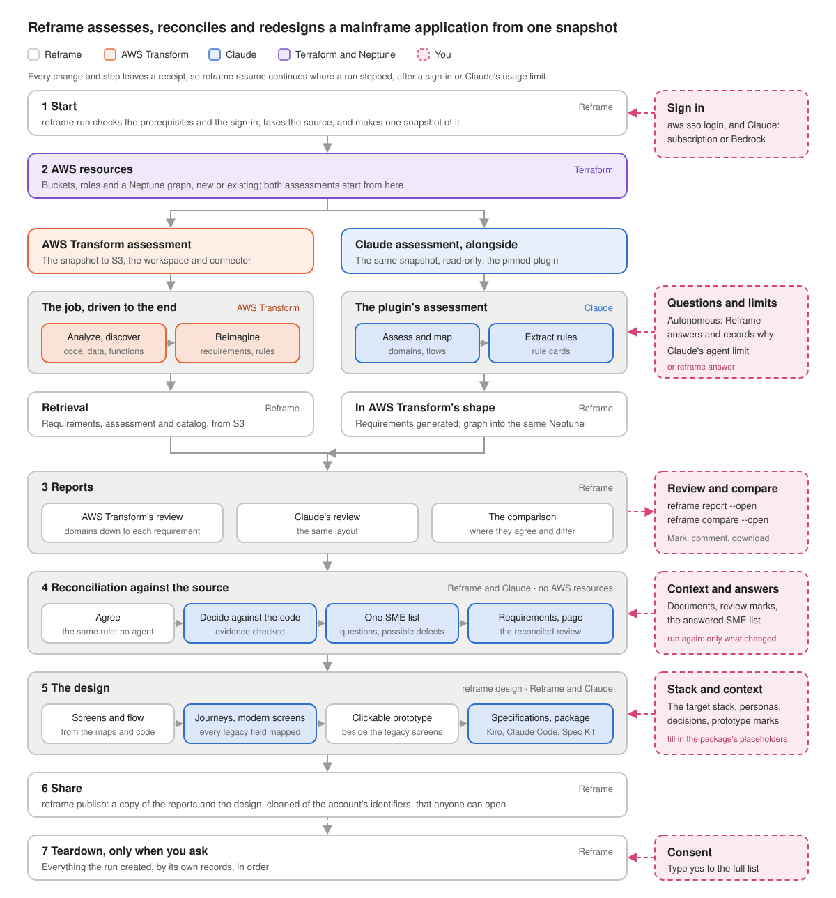

# How to run Reframe

One page, start to finish. The detail of each step is in [the guide](guide.md); every command and option is in [cli.md](cli.md).



## 0. Install, once

```bash
uv tool install "git+https://github.com/sknampally/reframe@v1.0.0"
```

Then choose what this computer will run:

```bash
reframe setup --tools claude
```

```bash
reframe setup
```

- **Claude only** (`--tools claude`) needs Git, [Claude Code](https://docs.anthropic.com/en/docs/claude-code), and the code-modernization plugin, which Reframe fetches. You don't need an AWS account. Claude signs in with your Claude subscription by default; `--auth api-key` uses `ANTHROPIC_API_KEY` instead, and `--auth bedrock --profile <profile>` uses Amazon Bedrock.
- **Both tools** also need an AWS account with AWS Transform. `reframe setup` checks the AWS CLI, Terraform and the AWS Transform MCP server, offers to install what is missing, and signs you in to AWS (`aws sso login`).

To work on Reframe itself, install a clone instead: `uv tool install --reinstall --editable <clone>`.

## 1. Work from your workspace folder

Run every `reframe` command from the same folder: your workspace. Reframe keeps everything for a project there, one folder per run:

```text
<workspace>/.reframe/
  <project>/                    for example genapp, aws-carddemo
    <run-id>/                   six letters and digits, one per run
      inputs/
        reconcile/              what you add for the reconciliation: documents, review downloads, the answered SME list
        design/                 what you add for the design: personas.md, decisions.md, target-architecture.md,
                                design-system/, style-reference/, prototype and review downloads
      outputs/                  everything Reframe makes for people to read
        report/  claude/  comparison/  reconcile/  design/
      ...                       Reframe's working records (state, event log, receipts, step logs)
```

`reframe` on its own shows the runs in this workspace and the next step. Reframe's own tools and settings stay in `~/.reframe`. Keep `.reframe/` out of Git: run folders hold your account's identifiers. Share the cleaned copy that `reframe publish` makes instead (step 7).

## 2. Assess the code

```bash
reframe run
```

The guided run first asks: *AWS Transform and Claude, or Claude only?* Then it asks for the source (a folder, a ZIP file or a GitHub URL) and a project name, plus your AWS profile when both tools are used. The assessments run on one snapshot, in the background:
- Claude's code-modernization plugin takes about two hours;
- AWS Transform takes about an hour, alongside it.

Without questions, for Claude only:

```bash
reframe run --tools claude --source https://github.com/aws-samples/aws-mainframe-modernization-carddemo
```

```bash
reframe status
```

```bash
reframe resume
```

`status` shows where the run is and what to do next. `resume` continues after an expired sign-in or Claude's usage limit, without repeating anything.

## 3. Read and review

```bash
reframe report --open
```

```bash
reframe compare --open
```

These open AWS Transform's business review and the comparison of the two tools. On a Claude-only run, `reframe report --open` opens Claude's business review, and there is no comparison. Reviewers mark items *Agree*, *Needs change* or *Question* and download their marks. Put the downloads in `inputs/reconcile/`.

## 4. Reconcile against the code

```bash
reframe reconcile
```

Reframe shows the estimate and stops above the batch limit. On a Claude-only run every Claude rule is checked against the code, in Claude's own domains and functions. Go ahead with `reframe reconcile --max-batches <n>`. Then read the result:

```bash
reframe reconcile --open
```

Put the answered SME list (`reconcile/questions.csv`, with the `answer` column filled in), more review downloads and sign-offs in `inputs/reconcile/`, and run `reframe reconcile` again: only what they bear on is decided again. `reframe review` shows each reviewer's coverage and sign-offs; `reframe export --to xlsx` writes everything as one Excel workbook.

## 5. Design the modern application

```bash
reframe design --plan
```

```bash
reframe design --open
```

`--plan` says what a round would redo and why, with no Claude step. `reframe design` then runs a round:
- the legacy screens and how they connect;
- the journeys, and modern screens with every legacy field mapped;
- a clickable prototype beside the legacy screens;
- a final specification for every capability (final where its function is signed off, draft otherwise);
- the AI-DLC package.

`--open` opens the design page.

To change the design, put more context in `inputs/design/` and run `reframe design` again. That can be personas, decisions, a design system, a style reference, the prototype's review downloads or sign-offs from the reconciliation page. Only the parts it touches are redone, and `design/changes-<round>.md` says what changed and why. Give the target stack when you know it; Reframe never chooses one:

```bash
reframe design --stack "React with TypeScript; Java 21 with Spring Boot; PostgreSQL"
```

## 6. Hand over to the forward build

```bash
reframe design --package ~/handover/<project>
```

This copies the package, cleaned, into an empty folder, in three forms: Kiro, Claude Code and Spec Kit. Open `START-HERE.md` there and fill in what only your team can give: the stack's detail, house conventions, skills and roles. Then see what is left:

```bash
reframe design --check ~/handover/<project>
```

## 7. Share (optional)

Publishing is optional: Reframe uploads or copies nothing unless you run one of these.

```bash
reframe publish --to reports/<project>
```

This writes a copy of every report, the design and the package, cleaned of your account's identifiers, that anyone can open in a browser. When the work is done, publish the whole run to your AWS account instead:

```bash
reframe publish --to aws
```

Only if you choose to, this puts the run in one private Reframe bucket in your account, under `<project>/<run>/`: `source/` (the snapshot both tools read), `results/` (what AWS Transform and Claude wrote) and `reports/` (the cleaned copy). Anyone whose AWS sign-in can read the bucket opens it with `reframe reports open <project>`. The bucket outlives teardown, so this works before or after step 8.

Or publish the cleaned copy to a GitHub Pages site, for anyone with the address:

```bash
reframe publish --to pages --repo my-org/reframe-reports
```

A Pages site is public, so Reframe names the repository and the address first and pushes only after you type `yes`.

## 8. Remove the AWS resources

```bash
reframe teardown
```

This lists everything the run created in AWS and deletes it only after you type `yes`. The reconciliation and the design need no AWS resources, so tear down as soon as both assessments are done. A Claude-only run created nothing in AWS, so it has nothing to remove.

## What it takes

| Step | Time | Claude, at API prices (CardDemo) |
|---|---|---|
| 2. Assess | about 1 hour (AWS Transform), about 2 (Claude), side by side | the plugin's agents, within your agent limit |
| 4. Reconcile | 30 to 90 minutes | about $30 to $70 for a full round; a later round only what changed; with Claude only, every rule is checked: estimated $15 to $40 |
| 5. Design | 30 to 60 minutes | about $35 for a first round; a round that redoes every screen about $60; a later round only what changed |
| 6, 7, 8 | seconds to minutes | none |
