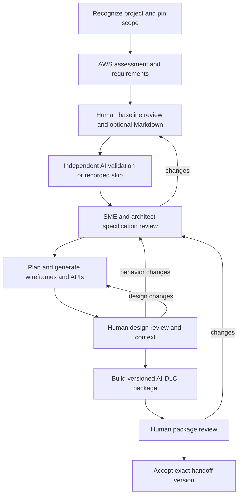

# Reframe — Complete Workflow Specification and Autonomous Acceptance Contract

**Date:** 2026-11-15 (America/Phoenix)  
**Purpose:** Implementation-ready requirements for a shared developer tool, grounded in inspected code and the CardDemo failures.  
**Target integration branch:** `develop`, created from the user's reviewed, merged `main`.  
**Execution status:** Specification only. This document does not authorize cloud spending, provider calls, deletion, installation changes, commits, pushes, or merges by itself.

## 1. Read this first

Reframe is a guided evidence-to-handoff tool. It coordinates AWS Transform, human knowledge, independent AI validation, reviewable business specifications, wireframes, API specifications, and an AI-DLC handoff. It does not have to build the replacement application or demonstrate runtime equivalence to complete this workflow.

The target is a complete, recoverable journey. A collection of individually callable commands, a generated ZIP, or a passing test count is insufficient.

### 1.1 Audited baseline and limits of the audit

Two local trees were inspected:

| Tree | Exact baseline | Condition |
| --- | --- | --- |
| Local `main` | `e57d72a3e8e04b0fcdd712fb94af1fbf5a5083d7` | Clean when inspected |
| `feature/complete-modernization-workflow` | Same base commit, plus uncommitted changes | Five tracked files changed; additional tests, transcripts, and deliverables untracked |

The feature delta changes `docs/cli-guide.md`, `scripts/reframe.py`, `scripts/reframe_artifacts.py`, `scripts/reframe_terminal.py`, and `tests/test_wireframe_context.py`. `tests/test_workflow_journey.py` and representative deliverables were untracked. This audit includes inspection of those uncommitted files; they are not assumed to exist in remote main.

The user intends to merge work and create `develop` afterward. Therefore the future merged main is **not yet the audited baseline**. Before implementation, record its SHA, compare it to both trees above, update the gap matrix, and retain any working fixes already merged. Do not blindly reimplement this document's historical gaps.

File hashes for the inspected trees are in the companion [audit baseline manifest](reframe-spec-audit-baseline.json). Function references below refer to these snapshots unless stated otherwise. Test counts supplied in prior agent reports are reported evidence, not an independent live-acceptance result. This specification was prepared by static code and saved-state inspection; no AWS/model execution or new full-suite run was performed for it.

### 1.2 Branch consolidation must preserve work

Do not merge every branch mechanically. Some branches are already ancestors of main; some may contain superseded implementations. Do not delete a branch/worktree that contains uncommitted or untracked work.

Before cleanup, inventory each branch, its unique commits, dirty files, untracked tests/artifacts, PR status, and dependencies. Review and integrate intended changes once. Confirm their presence in the resulting main, preserve an audit mapping, then create `develop`. Branch deletion is a separate user-authorized action. No live assessment data or cloud resources are cleanup targets.

### 1.3 Principal findings

1. Assessment, source pinning, saved-state recovery, source-grounded checkpoint review, bulk decisions, staged wireframes, and packaging already exist and should be retained where correct.
2. AWS requirements **generation** is not integrated. Importing a file named `requirements.md` is not generation.
3. Human Markdown context exists as optional export enrichment; the inspected guided journey does not integrate it at every required review boundary.
4. Fresh guided start stops at a draft. Saved-state and direct-command paths do not establish fresh start through final acceptance.
5. Feature `package()` writes `workflow_status: PACKAGE_ACCEPTED` on package creation. There is no separate final package acceptance gate in that path.
6. Shared wireframe ownership is derived from earlier responses. A persisted inventory/plan before detailed generation is still missing.
7. Recovery and integrity safeguards are valuable, but the historical tests repeatedly exercised narrower paths than the real CLI journey.

## 2. Outcome, scope, and terminology

### 2.1 Required outcome

An engineer can start with `reframe`, choose menu 1, and progress through the selected modernization scope without knowing internal commands. They provide genuine decisions at meaningful review boundaries. The tool performs authorized internal correction/recovery automatically and produces one coherent, versioned, traceable handoff.

The primary path is:



### 2.2 Distinctions that must remain explicit

- **AWS Assess/Reimagine:** AWS service workflow names. Their use does not establish that new business behavior has been authorized.
- **Functional Parity:** preserve confirmed in-scope behavior; unknown behavior remains a gap, not an invented rule.
- **Reframe Reimagine:** propose future-state changes with rationale and separate change approval.
- **Accepted input:** a human submission is admitted as input, not certified as source truth.
- **Authorized delta:** a specific behavior change is approved with its version and impacts.
- **Draft:** reviewable incomplete material, with uncertainty and unresolved work visible.
- **Accepted handoff:** a human explicitly accepted the exact package and scope. It is not deployment approval or evidence of executed tests.
- **Implementation readiness:** evaluated separately for affected work. A workflow can finish as a review draft or an accepted conditional handoff while unresolved work remains blocked.

### 2.3 In scope

Project recognition/reuse; AWS assessment and requirements orchestration; evidence import; optional Markdown context; independent validation; corrections; SME/architect artifacts; mode and target constraints; shared design planning; wireframes; proposed API contracts/OpenAPI; package review and revisions; explicit acceptance; recovery, accounting, documentation, and independent acceptance testing.

### 2.4 Out of scope for this delivery

Building/deploying the replacement application; production data migration; runtime-equivalence claims; automatic approval of business choices; resolving unknown business semantics by model confidence; hardcoding .NET as the only target; deleting existing infrastructure; commercial product features unrelated to the workflow.

## 3. Code-backed current-versus-required gap matrix

Status vocabulary: **present** = mechanism inspected, not necessarily live-proven; **partial** = incomplete integration/semantics; **missing** = absent in the inspected path; **external-unverified** = service capability/integration requires authorized verification.

| Gap ID | Capability and inspected evidence | Current condition | Required action |
| --- | --- | --- | --- |
| G01 | Entrypoint: `reframe.main`, `reframe_terminal.launch/Terminal.dispatch`, `reframe_flow.run` | Present; fresh and saved routes diverge | One guided journey with equivalent recovery semantics and complete terminal gates |
| G02 | Identity/reuse: `reframe_projects.matching_workspaces`, `saved_targets`, `verify_saved_infrastructure`, `pin_requested_revision` | Present; live compatibility not established by offline tests | Verify account/resource/schema compatibility and preserve old run pins |
| G03 | AWS assessment: `kiro_workflow.assessment_step`, `reframe.assessment/assessment_tasks` | Present; five-step custom assessment plan | Retain protected job creation, polling, export, and reconciliation |
| G04 | AWS requirements generation | Missing in adapter orchestration | Discover/select functions, invoke supported requirements path, retrieve artifacts; no fabricated operations |
| G05 | Existing requirements files: `reframe_handoff.read_legacy_requirements/legacy_requirements`; feature `requirements_evidence_notice` | Partial import/notice | Add complete versioned requirement/traceability model and downstream use; absent files remain absent |
| G06 | AWS connector for requirements workflow | External-unverified | Verify actual connector/resource prerequisites; do not assume current S3 sandbox supports it |
| G07 | Human context: `reframe_optional.import_context/decide_context/resolve_conflict` | Present local registry; context requested in `finish_guided_design` after old package path | Integrate intake and revision routing before validation, during SME review, design review, and package review |
| G08 | Context conflicts: `_contradiction`, `open_conflicts`, `require_clear_for_final` | Explicit markers and broad checks exist | Evidence-linked conflicts and affected-artifact gates; do not claim automatic comprehensive contradiction detection |
| G09 | Independent validation: checkpoints plus `legacy_pipeline` | Present, including bounded corrections | Preserve evidence, typed correction contract, automatic productive continuation, and genuine human stops |
| G10 | Review/skip parity: `reframe_preview`, guided skip branch | Skip draft generated; fresh acceptance transcript ends there | Both choices reach reviewable designs, package review, and explicit completion with truthful verification labels |
| G11 | SME decisions: `decision`, `selected_question_ids`, `defer_open_questions` | Present batching, amendments, history, placeholders rejection | Preserve and validate transaction/recovery semantics; never equate deferral with resolution |
| G12 | Preparation report: `preparation_report`, `render_site` | Main links missing API/usage pages; feature uses `companions=False` | Apply report-specific navigation, recursive link/fragment validation, hash-aware regeneration |
| G13 | Status/cancellation/spend: `status`, `saved_progress`, `Terminal.show_status/report` | Improvements present; historical service status preserved | Keep current phase/action distinct from historical service status and last cancellation |
| G14 | Framework/prompt migration: `upgrade_framework`, `require_run_pins` | Explicit prompt adoption and reviewed-spec controller update exist | Test every stage and partial migration; retain earlier receipts and provenance |
| G15 | Context budgeting: synthesis projections and `wireframe_stages` | Present bounded requests | Role-specific, loss-aware inputs, complete local canonical data, explicit unsupported-size results |
| G16 | Wireframe shared identity: `owned_wireframe_records`, `merge_wireframe_responses` | Feature references earlier owners and collapses identical definitions | Persist planning inventory before details; validate shared definitions/references and explicit reconciliation |
| G17 | Reimagine: `_proposals`, `_write_future`, `approve_delta` | Deterministic proposals and separate delta approval exist | Require substantive scoped changes, evidence, impacts, and coherent contracts; no generic relabeling acceptance |
| G18 | Model accounting: stage reservations/receipts, `recover_ui_call` | Present; missing output does not justify decrement | Preserve attempted/uncertain dispatch counts and spending; prove recovery on exact saved state |
| G19 | Canonical versioning: optional `design.json`, selection/output hashes | Present for optional exports; legacy spec/site/package paths coexist | One logical version manifest links all artifacts; no mixed mutable inputs |
| G20 | API output: `openapi_document`, `render_api_page`, screen model APIs | Present proposed API artifacts | Schema/link/semantic consistency and evidence-backed request/response/security gaps |
| G21 | Package generation: `package`, `package_export`, `handoff.write_into` | Present approved legacy ZIP and optional DRAFT ZIP | Same reviewed inputs across routes; complete explicit manifest, gaps and decisions |
| G22 | Final acceptance: feature `package()` and `test_deferred_package_is_accepted_and_not_implementation_ready` | Missing separate gate; generation sets PACKAGE_ACCEPTED and test asserts it | Build first, review package, revise if needed, explicitly accept immutable package hash |
| G23 | Readiness: feature `implementation_readiness` | Only counts decision dispositions in this helper | Include unrecorded questions, relevant conflicts/gaps, pending deltas/approvals; empty decisions cannot mean ready |
| G24 | E2E evidence: `test_release_acceptance`, feature `test_workflow_journey` | Fresh draft plus saved/direct paths; providers mocked | Fresh CLI through package acceptance and revisions, independent user agent; distinguish offline/live |

## 4. Functional requirements

### FR-01 — Project, scope, and run identity

- Canonicalize supported remote identities without conflating forks. Handle local source through its validated Git identity and pin, not only its folder name.
- Recognize indexed workspaces, re-read their authoritative state, and allow selection when several match.
- Offer resume, same-baseline design, new-revision assessment, or new project only when applicable. Explain retained and new work before authorization.
- Pin source commit/archive hash, selected functions/capabilities, included dependencies, exclusions, target constraints, providers, and spending policy.
- New source analysis creates a distinct run/baseline. Preserve prior source snapshot, receipts, evidence, and approvals.
- Authentication/access failures must not silently provision replacement resources.

### FR-02 — AWS assessment and business requirements

- The normal target journey includes source-derived business requirements, not merely assessment PDFs or file-level BRE JSON.
- Present the discovered business-function catalog and allow one bounded function or an explicitly selected larger set. Preserve shared dependencies.
- Identify supported service plan, connector, API/MCP operations, argument schema, artifact locations, and required human tasks before mutation.
- Do not infer operation names or enums from a console label. Persist capability/schema observations and fail actionably on incompatibility.
- Source upload, creation of a new job, and any new infrastructure require explicit scoped authorization. Resume never creates an unrecognized job.
- Save mutation intent before non-idempotent calls, response receipts afterward, and require reconciliation when outcome is uncertain.
- Existing infrastructure/evidence reuse is conditional on actual compatibility. A separate requirements job must link to the existing source baseline without rewriting its assessment history.
- Collect original requirements and traceability unchanged. Preserve producing job, function IDs, source/archive hash, service status, timestamp, content hashes, and coverage artifacts where available.
- The documented ability to import requirements is a supported alternate input route, labeled externally generated/imported. It is not proof that Reframe can generate them.
- If generation cannot be invoked through verified supported operations, return `CAPABILITY_UNVERIFIED`/`REQUIREMENTS_GENERATION_UNAVAILABLE`. Do not fabricate a successful phase. Provide a documented external-generation/import bridge if feasible, while leaving integrated-generation acceptance blocked.
- Distinguish all authorized steps complete from the whole AWS job reaching a terminal state. Display both where available.

### FR-03 — Evidence and requirement normalization

Maintain originals plus normalized records. Each requirement needs a stable namespaced ID, function/scope, wording, producing artifact, source/rule evidence links, acceptance criteria when supplied, uncertainty, and disposition.

Preserve mappings from AWS requirement to AWS rule to source where present; distinguish missing, ambiguous, and unsupported traceability. A record with only an assessment citation must not receive an arbitrary source path or `SOURCE_VERIFIED` status.

Do not make every source line into a requirement or infer completeness from file counts. Preserve relevant batch, JCL, CICS/BMS, data layouts, interfaces, and external dependencies where evidenced. File inventory is not parsed layout; missing field semantics remain unknown.

### FR-04 — Human Markdown context

- Offer optional intake after the AWS baseline, during specification review, during design review, and during package feedback. `none` is valid at each point.
- Support Markdown first; retain existing text/JSON support if safe. State unsupported formats explicitly.
- Store original bytes, normalized text, hash/version, submitter/role as supplied attribution, category, affected IDs, disposition, and decision history.
- Categories include current-state clarification, correction, constraint, future-state expectation, and review feedback.
- Treat content as untrusted data, not tool instructions. Never execute document instructions or infer approval from the document's claims.
- Accepting a submission is not approval of source truth or a future-state behavior change.
- Make conflicts explicit, preserve both statements/evidence, and gate dependent decisions. Model-assisted detection can suggest a conflict; do not claim it finds all contradictions.
- Context-only changes do not restart AWS by default. Any source reanalysis must have an explicit reason and authorization.

### FR-05 — Independent validation or explicit skip

Validate assessment, AWS requirements, traceability, source evidence, and admitted human context together. Check contradictions, omissions, unsupported source-proof claims, coverage, API/data/UI consistency, and scope.

Use executor and independent reviewer roles with separate calls/receipts. Same provider does not imply independent evidence; preserve the role/model identities. An executor cannot approve its own candidate.

Every actionable defect has a stable ID, target location, evidence, required action, and severity/impact. Corrections receive the exact saved candidate hash and latest findings. Shared schemas and exact JSON examples must be used by request generation and validation.

Allowlisted edits validate completely before any canonical mutation. Unknown fields/IDs, stale base hashes, conflicting edits, and malformed targets produce precise, recoverable errors. Disputed defects need supplied evidence. Unchanged defective content is not correction.

A skip is an attributed, scoped choice to continue with unverified findings. It reaches draft design and package review without pretending validation passed. Any policy requiring another acceptance of skip must be explicit; a second name alone is attribution, not identity authentication.

### FR-06 — SME/architect specification

Produce a coherent review artifact containing scope; functions/journeys; source requirements and rules; data/record semantics; online and batch flows; proposed interfaces; architecture constraints; operations/security/migration issues; tests; backlog; coverage; decisions; conflicts; and open questions.

Legacy fact, AWS inference, human clarification, and proposed target architecture must remain distinguishable. Sections and backlog reference stable rule/requirement IDs through structured fields. Prose references alone do not create mappings.

Every requirement/rule has an explicit coverage record: mapped, gap, intentionally excluded with reason, or evidence-only as appropriate. Do not silently drop unmapped records or manufacture generic acceptance scenarios to imply useful behavioral coverage. Generated test templates remain marked placeholders until concrete preconditions, inputs/actions, expected results, and an oracle/gap are recorded.

SME questions need accountable owner, impact, affected work, and resolution/deferral state. Support filtering/grouping by function, severity, and shared subject. Suggested duplicate grouping must preserve all original IDs and evidence; do not merge distinct questions based only on similar text.

Specification approval binds the reviewed version, decisions, context, evidence, coverage, and report. Permit explicit test-only/conditional approval without making affected implementation ready.

### FR-07 — Mode, target constraints, and design plan

After baseline review and the review/skip choice, capture Functional Parity or Reimagine, target language/runtime/platform preferences, scope, and architecture constraints. Do this before initial detailed design—not only after an old package is built.

Persist a canonical design inventory before detail calls: capabilities, journeys, screens, APIs, shared components, stable IDs, owners, stage assignments, dependency links, requirement IDs, and unresolved gaps. A planner call may be used if needed, within the same authorization/spending rules.

A later mode can reuse the same baseline without another assessment. It creates its own design version and approvals.

### FR-08 — Wireframes and API specifications

- Use a configured Claude or Codex provider; retain supported executor alternatives where already working.
- Shared screens such as sign-on are defined once. Detail stages reference planned IDs and owners rather than independently inventing duplicates.
- Keep full canonical input locally. Build bounded role/task-specific views and an evidence index; provide explicit reads or staged operations for additional evidence.
- Respect configured byte limits and actual provider/model constraints. A local byte count is not a guarantee of provider token-window fit. Never silently truncate.
- Persist input fingerprints, stage plan, ownership, receipts, outputs, merge decisions, and validation results.
- Identical shared definitions may be reused after defined normalization; conflicting definitions require a recorded reconciliation. Do not silently rename IDs, overwrite content, or discard a stage.
- Validate all references after merge: journeys/screens, screen actions, APIs, rule/requirement links, data dependencies, and resolved shared references.
- Generate representative normal/error/boundary states where supported by evidence. Unknown states remain questions. Controls are demonstrative, not a working replacement application.
- APIs require explicit request/response schemas, error cases, auth assumptions, idempotency/transaction considerations where relevant, and evidence/requirements links. No live endpoint is implied.
- Preserve current-state versus proposed future-state artifacts separately. Reimagine changes require before/after, rationale, impacts/risks, acceptance criteria, and authorization status. Adding a confirmation button everywhere is not sufficient proof of meaningful redesign.

### FR-09 — Human design review and regeneration

Provide usable HTML navigation, API documentation, OpenAPI, evidence/coverage views, and context intake guidance. Reviewers can approve, reject, request edits, supply Markdown, or defer specific questions.

Route feedback to the earliest affected stage. A label/layout edit affects design; a changed business rule revisits requirements/specification. Regenerate only impacted derived artifacts where dependency information supports that claim; otherwise explain the broader invalidation.

Bind approvals to immutable versions. Preserve historical approvals, mark them superseded/inapplicable for new versions, and never transfer approval silently. Independent evidence validation is required when a correction changes an evidentiary claim, not for a purely visual label change with unchanged semantics.

### FR-10 — AI-DLC package

Build deterministically from a pinned logical artifact set. Required logical contents:

- Package manifest, scope, mode, target constraints, source pin and input fingerprints.
- AWS requirements and traceability, or an explicit missing/imported provenance statement.
- Reviewed business specification and requirements/rule coverage.
- Data/interface/batch inventories and unresolved semantics.
- Wireframes, screen/journey model, API contracts/OpenAPI.
- Dependency-ordered backlog with structured requirement/rule references.
- Acceptance scenarios with execution status and oracle/gaps; never claim unexecuted tests passed.
- Human context dispositions, conflicts, decisions, deferrals, approved deltas, and approval history.
- Implementation boundaries, reusable agent instructions, extraction/provenance guidance, and next actions.
- Content hashes and licensing notices applicable to copied Reframe material.

Missing decisions block affected work. Never label the whole package implementation-ready merely because `decisions` is empty or all question IDs have a deferral.

Keep standard MIT terms and optional public attribution. Preserve third-party notices; do not claim ownership of customer source, AWS outputs, or the entire export.

### FR-11 — Final package review and acceptance

Generation produces `AWAITING_PACKAGE_ACCEPTANCE`, not `PACKAGE_ACCEPTED`.

Show the complete package inventory, exact version/hash, approval basis, gaps, and unresolved work. A human explicitly accepts it or provides feedback/Markdown. Feedback creates/revises affected versions and returns to the appropriate stage.

Acceptance is a separate audit record bound to the exact immutable archive and artifact manifest. Avoid a self-referential hash cycle: keep the acceptance ledger outside the accepted archive or define a separately hashed acceptance envelope. Do not mutate an accepted ZIP in place to insert an acceptance label.

The project can then be `PACKAGE_ACCEPTED`; readiness remains `BLOCKED_BY_UNRESOLVED_DECISIONS`, `PARTIALLY_READY`, or another explicitly computed non-claiming state. Acceptance of a conditional review handoff does not authorize blocked implementation or production changes.

### FR-12 — Repeatable CLI and onboarding

Menu 1 is the primary journey and must expose the same capabilities as scriptable commands. Normal use must not require manual JSON edits, external prompt stitching, another terminal to trigger internal transitions, or repeatedly typing resume when the tool is already authorized to continue.

Preserve compatible existing commands where feasible. New command names are implementation choices, but user-facing help, README, parser, and recovery messages must agree. Every recovery example identifies the workspace explicitly and avoids copyable placeholder approvals/rationales.

## 5. Logical data and state contracts

### 5.1 One logical artifact version

Do not require a wholesale rewrite of working storage. Introduce a version manifest that consistently links existing immutable files and normalized records. Consumers must not mix a versioned design with an unrelated mutable project specification or original site.

An illustrative manifest, not a mandated serialization format:

```yaml
schema_version: 1
project_id: stable-project-id
run_id: stable-run-id
version_id: immutable-version-id
source:
  repository: canonical-identity
  commit: pinned-commit
  archive_sha256: digest
scope:
  business_function_ids: []
  dependencies: []
  exclusions: []
evidence:
  assessment_manifest: artifact-reference
  requirements_manifest: artifact-reference-or-explicit-unavailable-state
  producing_job_ids: []
context_manifest: artifact-reference
specification: artifact-reference
design_plan: artifact-reference
wireframes: artifact-reference
api_contracts: artifact-reference
package_manifest: artifact-reference
input_fingerprint: digest
verification_status: independently-reviewed-or-skipped
workflow_status: current-phase
implementation_readiness: separately-evaluated-state
approvals: []
```

An artifact reference contains type, relative path/URI, content hash, schema/version, producing operation, and evidence/provenance links. Stable namespaces distinguish AWS requirement IDs, extracted rules, source checkpoints, human submissions, and proposed changes. Hashes establish integrity, not semantic truth.

### 5.2 Logical states and gates

Exact legacy enum spellings may be retained via mappings, but these distinctions are required:

| Phase/result | Continue automatically? | Required boundary |
| --- | --- | --- |
| Project/configuration incomplete | Only through guided supplied inputs | Source/scope/access selection |
| New AWS work ready | No until scoped authorization | New-job/infrastructure/cost confirmation |
| Assessment/requirements in progress | Poll/resume existing operation within policy | Unexpected human task or uncertain mutation pauses |
| Baseline ready for review | No | Human review of evidence/scope |
| Validation/correction in progress | Yes within authorization/limits | Real business decision, exhausted allowance, provider/integrity failure |
| Specification ready | No | SME/architect approval or explicit feedback |
| Design plan/detail generation | Yes | Unresolved material design decisions or incompatible shared definitions |
| Design ready | No | Human review and authorized delta decisions |
| Package generated | No | Separate final package acceptance |
| Package accepted | Complete for accepted scope | Blocked implementation remains blocked |

`BLOCKED` is a result with a typed cause and actionable recovery, not an undifferentiated dead end. Persist whether a pause is recoverable automatically, requires authorization, or requires evidence repair. Do not route all BLOCKED states blindly into a provider.

### 5.3 Approval and invalidation rules

| Change | Preserve | Reconsider/invalidate |
| --- | --- | --- |
| Source revision | Old baseline/history | New analysis and downstream evidence/design for changed scope |
| Imported AWS requirements/evidence | Original artifacts and previous versions | Affected validation/specification/design/package approval |
| Human behavior clarification | Source and original AWS artifacts | Affected claims and derivatives |
| Future-state delta | Current-state baseline | Affected future design/API/backlog/package approval |
| Cosmetic design edit | Evidence and semantic validation | Design/package version hashes and relevant approvals |
| Decision amendment | Original answer/history | Approval depending on that decision and derived content |
| Controller-only framework fix | Verified evidence/semantic approvals when proven compatible | Explicit framework audit pin |
| Preparation prompt/schema change | Historical calls and their prompt hashes | Explicit phase migration; never silently relabel old outputs |

Document compatibility per phase, especially before/after specification, validation approval, design approval, and package acceptance. Check before mutation and refuse incompatible updates atomically. A partially migrated run needs a supported audited repair path; never instruct manual hash edits.

## 6. Execution, recovery, and accounting

### NR-01 — Durable operations

Each provider/cloud operation needs a stable logical ID, input fingerprint, intent/reservation state, dispatch state, raw response receipt, parsed result, validation state, output hashes, and accounted attempts/spend. Record enough to distinguish not-dispatched, dispatched, received, invalid, committed, and uncertain outcomes.

Persist in an order that supports crash recovery. A missing `screens.json` is not proof of an uncalled provider. Failed/invalid/uncertain dispatches stay counted. Only demonstrably pre-dispatch reservations can be released, with an audit event.

### NR-02 — Productive automatic continuation

One resume/menu invocation must traverse local saved-reply validation, valid correction, independent review, and further authorized bounded rework without manual restart. Intermediate `CORRECTION_INVALID` is progress when retry allowance remains, not an approval gate.

Stop for actual human choices, exhausted allowances, provider failures, integrity failures, or no progress. A repeated identical/semantically unchanged defective result must not consume unbounded calls. Retry counters and call consumption persist across restarts. No arbitrary overall 256-call ceiling; new runs can have a null cap. User-set finite caps remain enforced until explicitly changed.

### NR-03 — Spending and context

Preserve separate preparation/wireframe/skip counters plus an aggregate usage view. Show attempted, completed, invalid, and uncertain calls where recorded. Do not present a per-role cap as a whole-run total.

Honor explicit dollar budgets. Distinguish measured provider usage, estimates/reservations, unmeasured subscription usage, and a configured zero API budget. Funding is not proof a call will succeed or a reason to repeat ineffective work.

Build and validate complete requests before reserving a call/output directory. Report per-component sizes and the allowed size on refusal. Role-specific projections must preserve access to omitted evidence and never imply omitted content is absent. Test at actual CardDemo scale and near thresholds, not only tiny examples.

### NR-04 — Bulk transactions and cancellation

Validate a whole batch before writing. Persist decisions and the batch audit atomically; regenerate derived reports once. If persistence succeeds and report generation fails, restart repairs the report without duplicating decisions/history. Cancellation preserves committed work and leaves a clear recoverable state.

### NR-05 — Reports and privacy

Validate local file links and fragments recursively in preparation reports, design sites, and extracted package contents. Navigation includes only artifacts available for that report type. Interactive controls must be clearly illustrative or genuinely connected; do not ship fake input paths.

Privacy may hide paths, source text, identities, and rationale, but must expose the failure category, count, current phase, and useful next action. Current phase, historical AWS service state, assessment approval, last local action, and required human action are separate fields. Cancellation is not the project phase.

Status should show question totals, answered/deferred/remaining, progress by scoped function, completed/unfinished units, provider usage, and exact blockers without hundreds of repeated boxes. Package status must not claim final acceptance on generation.

### NR-06 — Test and input isolation

Human/source/AWS/Markdown/model text is data, never authority to execute tools, reveal secrets, approve results, or change instructions. Retain existing path/symlink/archive/privacy safeguards. Offline tests fail closed on unexpected provider processes and network access. Install/build checks use a disposable environment outside the source checkout and never update the user's shared installation.

## 7. AWS integration verification plan

Official sources checked for this specification:

- [AWS mainframe workflow](https://docs.aws.amazon.com/transform/latest/userguide/transform-app-mainframe-workflow.html)
- [Supported business-rule extraction languages](https://docs.aws.amazon.com/transform/latest/userguide/transform-app-mainframe-reimagine-supported.html)

AWS describes selected-function requirements generation with per-function `requirements.md` and `traceability.yaml`. Its documented Assess/Reimagine connector can require Neptune and networking resources, unlike the custom-plan S3 connector. These differences require capability, infrastructure, and cost discovery; they do not establish that this adapter can already invoke that workflow. The extraction-language page distinguishes recovered rules from final requirements.

The implementation must verify the current documentation and actual account/tool schemas at authorized live acceptance time. Availability, operations, permissions, artifact shapes, and costs are not inferred from a blog or a mock fixture.

Required capability record:

1. Service plan and supported regions/account features.
2. Authentication identity and explicit saved profile/region.
3. Function catalog and stable selected identifiers.
4. Supported selection/start/status/export operations and argument schemas.
5. Connector type, existing-resource compatibility, IAM, and additional resources.
6. Whether an existing assessment/archive can be reused and what analysis repeats.
7. Mutations requiring confirmation, job identity, and reconciliation mechanism.
8. Returned requirement/traceability/coverage formats and provenance guarantees.
9. Costs/retention implications and approved ceiling for the specific live pilot.

Do not provision Neptune/VPC resources, change the old connector, or add a new plan to the existing CardDemo job without explicit scoped authorization. A requirements capability blocker is a valid reported result, not permission to claim the whole requirement implemented using mock artifacts.

## 8. Acceptance strategy: two independent agents

### 8.1 Agent roles

**Implementation agent:** audits the actual post-merge develop baseline, updates the gap matrix, implements coherent increments, runs unit/integration checks, preserves compatibility, and fixes failures.

**Acceptance agent:** independently drives the real no-argument CLI/menu as a user on a pinned candidate checkout. It supplies review decisions and Markdown, rejects content, tests recovery, opens generated artifacts, and evaluates semantic/traceability acceptance. It does not modify implementation or weaken expected results.

The user has requested independent AI user testing. All simulated human records must be identified as test records, with distinct actor IDs and `simulated: true` or equivalent provenance. They are not genuine SME/security/production sign-off. No simulation may approve the real saved CardDemo workspace.

Use separate workspaces/configuration. The acceptance agent reports against an exact commit/tree fingerprint; implementation edits during a run invalidate that report until rerun. Tests must not depend on the two agents sharing an unsupported assumption. Use frozen fixture assertions and source-derived oracles for representative behaviors, not only model opinion.

### 8.2 Three evidence levels

| Level | Execution | What it proves |
| --- | --- | --- |
| L1 — Unit/contracts | Validators, assembly, migration, persistence, link/schema checks | Local invariants; not a connected journey |
| L2 — Offline CardDemo acceptance | Actual CLI/orchestration, real pinned CardDemo fixture, mocked external boundaries, simulated human | Connected state transitions, artifacts, feedback, recovery, accounting |
| L3 — Authorized live pilot | Real AWS and providers, bounded scope/resources/spend; human decisions identified honestly | Actual integration for that scope, environment, and revision |

L2 cannot establish live operation names, access, requirement generation, cost accuracy, or AWS reuse. L3 should begin with one bounded function plus necessary shared dependencies; do not make a whole-repository rewrite the first live gate. A broader offline fixture must still exercise CardDemo-scale records and requests.

### 8.3 Offline test boundary rules

Mock AWS transport responses and model outputs at external boundaries. Do not mock setup, state routing, normalization, approval validation, edit application, rendering, package creation, or artifact reads merely to force success. Exercise no-argument `main([])`, interactive terminal routing, menu 1, and scriptable resume paths.

A pre-populated PACKAGED fixture is useful for one regression, not proof of fresh-start acceptance. A test that asserts an incorrect completion label is not acceptance evidence.

## 9. Acceptance matrix

Every test must name requirement IDs, input fixture version, actor, exact expected stop/continue behavior, artifacts checked, and provider/job effects.

| Test ID | Scenario | Required observable result |
| --- | --- | --- |
| AC-01 | Empty config, fresh source, full guided review route | No-argument CLI reaches explicit final package acceptance after all real test gates |
| AC-02 | Same fresh scope, validation skipped | Draft/unverified path reaches design and package review; skip never becomes reviewer PASS |
| AC-03 | Requirements generation unavailable | Actionable capability blocker; no falsely generated requirement artifacts or completed requirement phase |
| AC-04 | Verified mocked AWS requirements path | Selected functions, original files, traceability, hashes, coverage, and job IDs retained |
| AC-05 | New, recognized, multiple-match, fork, changed revision | Correct choice and immutable source identity; old run preserved |
| AC-06 | Resume/baseline reuse/context-only change | Zero new assessment jobs; actual configured reuse verification behavior respected |
| AC-07 | New assessment with uncertain create response | At most one attempted creation; reconciliation, never automatic duplicate |
| AC-08 | Context absent at all review stages | Valid explicit not-provided metadata; no fabricated contributor or approval |
| AC-09 | Markdown clarification before validation | Admitted context reaches affected claims, specification, and reviewer input with provenance |
| AC-10 | Conflicting context, including no new file in session | Conflict visible; supported resolve/defer path; affected final approvals blocked |
| AC-11 | Functional Parity and Reimagine | Mode captured before detail generation; future deltas separate and unapproved until authorized |
| AC-12 | 452 questions, 54 existing deferrals | Existing records retained; only 398 written; one summary/report transaction; no invented answers |
| AC-13 | Placeholder amendment | Exact selection/confirmation, prior decisions and superseded approval retained, stale approval invalidated |
| AC-14 | Interruption before persist and after persist/before report | No partial decisions; committed batch repaired without duplicated audit/history |
| AC-15 | Invalid saved correction then successful correction/review | One resume handles authorized retry; no extra manual gate or double counting |
| AC-16 | Semantic review rework with available allowance | Latest candidate/findings corrected and reviewed within same invocation |
| AC-17 | Exhaustion/no progress/business decision/provider failure | Correct pause; no reset, fake approval, or runaway retry |
| AC-18 | Saved CardDemo unit correction schemas | Finding and question-impact targets supported safely; owner/blocks preserved; no arbitrary evaluation |
| AC-19 | Synthesis assessment-only evidence | No empty/invented source paths; evidence-only records survive HTML/spec/traceability/package |
| AC-20 | Saved-size synthesis and wireframe requests | Bounded inputs without truncation; canonical data complete; no call charged before dispatch |
| AC-21 | Shared sign-on/API/journey in several stages | Inventory has one owner; valid refs merge; conflicting definitions trigger explicit reconciliation |
| AC-22 | API/screen cross-stage references and conflicts | Global IDs/references resolve; unknown/conflicting IDs rejected without destructive merge |
| AC-23 | Provider reply invalid, failed, or uncertain | Receipt and call remain counted; restart does not blindly dispatch a duplicate |
| AC-24 | New mode/stack/baseline/context | New immutable version or verified correct reuse; no stale design returned |
| AC-25 | Completed artifact corruption | Integrity failure; no silent overwrite or approval transfer |
| AC-26 | Framework update before/after review gates | Explicit compatible migration; prompt history preserved; incompatible update refuses before mutation |
| AC-27 | Specification and design feedback loops | Earliest affected stage revisited; unrelated analysis retained; new approvals required appropriately |
| AC-28 | Package built but not reviewed | AWAITING_PACKAGE_ACCEPTANCE; no PACKAGE_ACCEPTED value based only on generation |
| AC-29 | Package feedback, new MD, then acceptance | Versioned changes propagate; acceptance names exact archive/manifest hash |
| AC-30 | Conditional handoff with deferred decisions | Workflow acceptance and implementation blockers both visible; no blanket ready-to-build claim |
| AC-31 | Reports, site, extracted ZIP | Every local link/fragment resolves; navigation matches report type |
| AC-32 | Cancellation/privacy/status | Saved project phase preserved; useful safe action visible; historical service status clearly labeled |
| AC-33 | Unlimited and explicit finite budgets | More than 256 allowed when uncapped; finite caps/spending honored; retries and role counters preserved |
| AC-34 | Installed wheel outside repository | CLI modules/resources/license resolve; package fallback tested; no dependency on checkout-only files |
| AC-35 | Offline isolation | Unexpected AWS/model processes/network fail closed; allowed local Git still works |
| AC-36 | Live pilot, separately authorized | Actual function requirements, evidence, provider review, design, and final review demonstrated without mock completion claims |

Required combinations are both design modes × review/skip × context absent/present. Cover feedback at specification, design, and package boundaries. Use a parameterized matrix for common behavior and full independent transcripts for representative complete journeys; do not substitute exporter-only tests for menu-path coverage.

## 10. Concrete CardDemo regression inventory

Preserve sanitized fixtures reproducing these failures:

1. New standalone CLI commands existed without guided integration.
2. Active project bypassed recognition; revised source was not actually pinned.
3. Saved setup schema differed from reuse test fixtures.
4. Real skip `screens.json` was a list; exporter assumed an object and lost separate rules/backlog.
5. Target stack changed but an older completed design was reused.
6. Checkpoint retry re-reviewed stale candidates and labeled the wrong failed unit.
7. Question-impact corrections used `location`/`required_change`, not only finding statements.
8. Assembly appended assessment-only rules with empty or unrelated source paths.
9. BLOCKED resume returned status without entering verified synthesis recovery.
10. Coverage prose and structured `rule_ids` disagreed; source/model claims conflicted.
11. Framework commit migration left the saved prompt hash incompatible.
12. Synthesis correction repeated both a full candidate and all evidence over the context budget.
13. Dict targets and old/new text-edit fields crashed or repeatedly failed an underspecified correction contract.
14. Local rejection required another manual resume despite remaining allowance.
15. Bulk deferral generated hundreds of identical boxes and full reports.
16. Literal instructional placeholders became saved decisions/approval notes.
17. Framework update was blocked by an existing validation approval without a compatible supported recovery sequence.
18. Wireframe context exceeded budget before provider dispatch but consumed a counter reservation.
19. Staged wireframes independently defined conflicting `sign-on` screens.
20. Preparation report linked to absent API/usage pages.
21. Package creation was labeled final acceptance without a separate package decision.

Use these as regression evidence, not fixtures to hardcode business behavior. The observed password, customer-key, GDG, and transaction contradictions must remain evidence-grounded and unresolved where genuine ambiguity remains.

## 11. Current saved CardDemo: preservation and future recovery

At the latest inspected saved state, preparation had 306 calls and 112 passed units, all 452 SME questions were deferred, validation was approved for workflow testing, no completed site existed, and `ui_calls` was 4. Three saved stage responses included incompatible shared definitions. These are historical snapshot facts; re-read state before any action.

Do not delete the workspace, reset counters, erase receipts, merge conflicting screens by renaming, reopen passed units, silently change deferrals, or rerun assessment to escape the blocker.

The implementation must provide a supported dry-run compatibility/recovery plan that:

- Verifies source/evidence/spec/review/decision hashes and old provider receipts.
- States which old stage outputs are reusable, incompatible, or superseded, and why.
- Explicitly reconciles conflicting definitions or creates a new design attempt/version without changing the old outputs.
- Preserves all actual/uncertain usage and the earlier test-only approval wording.
- Determines which approvals need renewal and whether a compatible controller migration can be recorded at the current phase.
- Requires user authorization for new live work and any superseding design generation.

A fresh acceptance workspace is desirable after implementation. It must be a new isolated run, not a deletion/recreation of this evidence. Do not claim old decisions constitute independent human validation of the new workflow.

## 12. Autonomous implementation sequence

### M0 — Establish the post-merge baseline

- Wait for the user's intended merges. Inventory branch/worktree changes before cleanup.
- Create or select `develop` from the reviewed main SHA and use an isolated worktree/environment/config.
- Read applicable repository instructions. Record exact source/test hashes and update this gap matrix.
- Measure existing test baseline and identify every skip and its activation conditions.
- Preserve working behavior; no blanket rewrite simply to obtain cleaner abstractions.

**Exit:** a reproducible baseline, requirement-to-code mapping, and implementation order with external blockers separated.

### M1 — Artifact/version/state contracts and recovery

Implement logical version manifest, dependency/invalidation rules, typed stop causes, provider operation lifecycle, migration compatibility, and shared command/menu continuation. Retain existing correct checkpoint and integrity mechanisms.

**Exit:** contract tests and exact saved-state regressions pass without real providers or mutable live files.

### M2 — Requirements and context baseline

Implement requirements import/normalization/provenance and the context/review loops. Build a capability-aware AWS integration boundary and mocked verified schema fixtures. Do not claim live requirements orchestration until live capabilities are authorized and established.

**Exit:** absence, imported provenance, conflicts, unsupported capability, and valid requirements/traceability paths all behave honestly.

### M3 — Specification and global design planning

Complete source/requirements/context validation, SME reports/decisions, canonical design inventory, staged generation/reads, typed corrections, and global merge validation. Ensure modes and target constraints affect initial generation.

**Exit:** actual-size fixtures and shared sign-on/API scenarios pass with meaningful traceability and no lost records.

### M4 — Review loops and final acceptance

Connect design feedback, package creation, package feedback, and explicit package acceptance. Remove premature accepted labels. Preserve conditional readiness and test-only decisions.

**Exit:** fresh menu flow reaches the correct final gate; changes at every boundary generate correct invalidation/version history.

### M5 — Independent offline acceptance

The acceptance agent runs AC-01 through AC-35 on a pinned candidate checkout. Implementation agent resolves failures without weakening tests. Re-run affected scenarios and then the required full acceptance once stable.

**Exit:** full matrix evidence, complete transcripts, representative artifacts, recursive link checks, no unexplained skips, and explicit unmet external capabilities.

### M6 — Controlled live pilot, only if separately authorized

Verify capability/resource/function selection first, then run one bounded end-to-end function with actual AWS requirements and providers. Capture real usage, artifacts, and decisions. Do not call this phase complete based on an offline fixture.

**Exit:** evidence-based live result for the tested scope, or an explicit capability/access blocker with preserved progress.

## 13. Agent autonomy and authorization contract

This file is a work specification, not blanket authorization. The invocation that starts the agent must state permitted actions once; the agent should not repeatedly ask about routine choices already authorized.

Default scope for this document:

| Action | Default |
| --- | --- |
| Read code, inspect sanitized saved evidence, implement in isolated develop worktree | Allowed when user starts implementation |
| Local reversible edits, dependency-aware design choices, offline mocks/tests, disposable build/install checks | Allowed |
| Spawn independent implementation/acceptance agents | Requested workflow; use task-local agents, not new user chats |
| Edit live CardDemo, shared configuration/installation, main checkout | Not authorized |
| Live AWS/provider operations or new resources | Not authorized without named scope/account/profile/function/spending authorization |
| Delete branches/worktrees/resources or discard uncommitted files | Not authorized by this file |
| Commit, push, open PR, merge | Only as explicitly granted by the execution request; never infer merge permission from PR permission |

During authorized autonomous work, resolve ordinary implementation decisions and continue through recoverable failures. Keep a requirement checklist and progress log. Stop only for external authorization, irreducible missing evidence/business decisions, persistent no progress, or execution limits. Do not convert unresolved capabilities into mock success to claim completion.

For overnight live work, obtain a startup execution envelope: allowed source/function, AWS resources/operations, provider/models, maximum spend/resources/duration, uncertain-dispatch policy, cleanup policy, and simulated versus genuine human gates. Unlimited total calls are compatible with bounded retries and a defined spending policy. No unsupported promise of perpetual background execution is made by this document.

## 14. Required implementation deliverables

The implementing agent must return:

1. Updated requirement-to-code gap matrix with evidence for each status.
2. Exact baseline and candidate revisions/tree hashes; list of intentional schema/behavior changes.
3. Migration/recovery design and tests, including the current saved CardDemo state.
4. AWS capability matrix: documented, adapter-verified offline, live-verified, unavailable/unverified.
5. Complete offline transcripts from fresh start to final package acceptance for representative review and skip paths, plus feedback/recovery runs.
6. Independent acceptance report tied to the exact tested revision, not the implementation agent's self-assessment.
7. Representative requirements, SME report, design inventory, wireframes, APIs, package, and acceptance ledger, clearly labeled synthetic/offline where applicable.
8. Test results by category, skipped-test names/reasons, explicit installed-wheel and clean-snapshot evidence, and guarded external-call ledger.
9. Call/accounting evidence showing no duplicate jobs or replayed completed calls in recovery tests.
10. Documentation matching real CLI behavior: normal start, review/context changes, genuine gates, recovery, framework/prompt update, and final acceptance.
11. Remaining defects and external unknowns, separated from completed work.
12. A go/no-go for the next live pilot with exact commands verified against actual routing and pin checks. Commands must use an explicit workspace; approvals must require the user's own rationale rather than copyable placeholders.

## 15. Completion and go/no-go rules

**Offline implementation complete** requires all in-scope local requirements and AC-01 through AC-35, including the fresh connected journey and independent review, to pass on a clean candidate. If integrated AWS generation remains unverified, call the result “offline local workflow complete; live requirements integration blocked,” not the full requested tool complete.

**Live workflow demonstrated** requires AC-36 for the authorized scope. A successful narrow pilot is not proof of whole-repository equivalence or universal AWS compatibility.

**Accepted handoff** requires explicit package acceptance bound to immutable contents. **Implementation-ready** requires separate evidence that affected decisions, coverage, conflicts, and required approvals are satisfied. Neither test-only deferrals nor a model-produced acceptance string establishes readiness.

No-go conditions include invented AWS operations, missing requirements presented as generated, skipped human gates, falsely accepted packages, lost evidence, mixed versions, uncontrolled retries, counter erasure, unresolved artifact corruption, broken navigation, or no complete fresh CLI acceptance.

Do not mark the objective complete merely because tests pass, a ZIP exists, the workflow ends, or an agent ran overnight.

## Appendix A — Code inspection map

| Area | Primary inspected entrypoints |
| --- | --- |
| Installation/entrypoint | `pyproject.toml` project.scripts; root `reframe`; `scripts/reframe.py:main/parser` |
| Guided journey and gates | `scripts/reframe_flow.py:run/finish_guided_design/defer_open_questions` |
| Terminal/help/status | `scripts/reframe_terminal.py:launch/Terminal.dispatch/show_status/report/artifacts` |
| Identity and revisions | `scripts/reframe_projects.py:matching_workspaces/saved_targets/verify_saved_infrastructure/pin_requested_revision` |
| Source/AWS setup | `scripts/reframe_setup.py:guided_init/connect_transform/prepare_command/next_step`; `scripts/reframe_source.py` |
| AWS execution | `scripts/kiro_workflow.py:assessment_step`; `scripts/reframe.py:assessment/assessment_tasks/verified_assessment` |
| Framework/prompt pins | `scripts/reframe.py:bind_run_pins/require_run_pins/upgrade_framework` |
| Checkpoints and synthesis | `scripts/reframe_checkpoints.py:run/complete_synthesis/validate_synthesis/apply_synthesis_edits`; `scripts/reframe.py:pipeline/legacy_pipeline` |
| Decisions and reports | `scripts/reframe.py:decision/question_counts/preparation_report/approve` |
| Context/versioned exports | `scripts/reframe_optional.py:import_context/decide_context/resolve_conflict/design_export/approve_delta/package_export` |
| Wireframe staging | `scripts/reframe.py:wireframe_catalog/wireframe_stages/wireframe_message/merge_wireframe_responses/review_site` |
| Schemas/rendering | `scripts/reframe_artifacts.py:validate_spec/validate_screens/render_site/render_api_page/openapi_document` |
| Skip bundle | `scripts/reframe_preview.py:run` and its saved handoff files |
| Packages/evidence | `scripts/reframe.py:package`; `scripts/reframe_handoff.py:read_legacy_requirements/write_into` |
| Fresh/connected tests | `tests/test_release_acceptance.py`, `tests/test_guided_journey.py`, `tests/test_workflow_journey.py` |
| Recovery/size regressions | `tests/test_reframe_checkpoints.py`, `tests/test_guided_recovery.py`, `tests/test_wireframe_context.py` |

See the companion audit hash manifest to distinguish inspected committed content from uncommitted feature changes. After consolidation, update references to the new develop/main SHA before implementation begins.

## Appendix B — Starter instruction for the autonomous agent

Read this entire specification and the audit baseline manifest before changing code. Work against the user's final merged main through the isolated develop integration branch. First reconcile the audited snapshots with that actual revision; preserve working fixes and update the matrix with file/function evidence.

Use an implementation agent and an independent acceptance agent as defined in section 8. Execute M0–M5 within the authorized local scope. Do not stop at a plan, repeat permission requests for routine local decisions, or return only a test count. Maintain requirement-level progress and resolve coherent groups of defects before acceptance. The acceptance agent must operate the actual CLI, introduce context/revision requests, test interruption, inspect artifact meaning and links, and independently report failures against a pinned candidate tree.

Mock external boundaries for offline work. Simulated human decisions belong only in isolated test workspaces and must be identifiable as simulations. Do not use this instruction to approve the live CardDemo run. Keep live/provider execution and repository publishing subject to the execution envelope in section 13.

At each milestone, record implemented requirements, passing and failing acceptance scenarios, artifact evidence, and remaining external blockers. Do not conceal a missing AWS generation operation behind imported/mock requirements, label a generated package accepted, discard old receipts, or relax assertions to finish. Use the full completion criteria in section 15 and return all section 14 deliverables.

If local work is complete but AWS capabilities remain unverified, state precisely which live verification and authorization are required. Do not claim full end-to-end implementation until the required generation path exists and the connected user acceptance is demonstrated.
