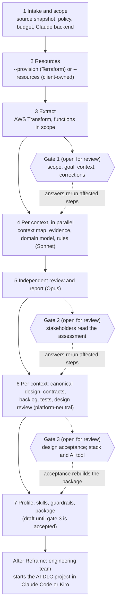

# Reframe specification v2

Status: revision 2, 18 November 2026. This file is the source of truth; change it only as [the change process](README.md) describes. Plan: [plan.md](plan.md).

Reframe takes a mainframe repository through AWS Transform and produces an AI-DLC-ready package: source-checked business rules, a domain model, interactive wireframes, interaction contracts, and skills and guardrails for the tech stack chosen at the last gate (.NET and Blazor on AWS by default). People add context at three scheduled gates while the run carries on in the background. Engineers then load the package into their own AI-DLC project through Claude Code or Kiro and take the build forward; Reframe does not run AI-DLC.

Revision 2, 18 November 2026. This revision answers the SME, architect and client review of the same date (appendix A lists each finding and what changed). It keeps the direction and makes four things explicit: a deadline never creates an approval, a citation is not verification, every output comes from one versioned model, and nothing unresolved becomes an implementation rule by default. Updated later the same day at the owner's request: scheduled reviews no longer hold the run, and the Claude backend is the Claude Code CLI for internal testing and Amazon Bedrock for client work. A second review the same day (U01 to U12) tightened waiting states, recovery, deletion, the two Claude backends, the background worker, design import and the package tree; appendix B lists each. A final consistency pass the same day closed seven gaps and added change control (section 15).

## 1. Purpose, scope and support

Reframe turns a mainframe repository into a traceable engineering handoff that starts an AI-DLC project. It is engineering input with stated limits, not a claim of runtime equivalence and not authorization to deploy.

In scope:

- COBOL, copybooks, BMS maps, JCL, CICS and batch programs, and the data definitions they use, analysed by AWS Transform.
- Checking AWS Transform's business rules and requirements against the pinned source, with findings kept visible.
- An independent Claude review and an assessment report for stakeholders.
- A context map, a domain model per bounded context, a business rules catalog, interactive wireframes, interaction contracts, a backlog and acceptance scenarios, all platform-neutral.
- Skills, guardrails and a technical environment for the stack chosen at gate 3, written for Claude Code or Kiro.
- An AI-DLC-ready package (awslabs/aidlc-workflows, pinned release) with a tool-neutral core that engineers not using AI-DLC can read.
- Creating, or checking client-owned, AWS resources for a run.

Out of scope:

- Running AI-DLC and writing the application: the engineering team does that and answers AI-DLC's questions.
- Claims of runtime equivalence with the mainframe, and parity testing. Behavioural parity tests against captured mainframe inputs and outputs are a later phase.
- Production data migration, deployment, and deployment authorization.
- Approving business behaviour on anyone's behalf: silence, a deadline or a model's confidence never counts as approval.

### Initial support matrix

| Area | Supported in v2 | Not supported yet |
| --- | --- | --- |
| Source | COBOL, copybooks, BMS, JCL, CICS, VSAM, DB2 definitions | IMS and MQ are modelled and their gaps labelled; no mapping is generated for them |
| Source input | Git repository, local checkout, S3 ZIP | Inputs without a content manifest |
| Extraction | AWS Transform for mainframe, through its MCP server | Other extractors |
| Model backend | Claude Sonnet 5.5 (generation) and Opus 5.5 (review), through the backend named in the project's data policy: the Claude Code CLI for internal testing, or Amazon Bedrock in the customer's account for client work (section 11) | Other models; the Anthropic API called directly |
| Target | .NET and Blazor on AWS | Other profiles until a project brings acceptance evidence |
| AI tool for the team | Claude Code, Kiro | Others read the tool-neutral core |
| AI-DLC | v2.11.4, pinned | Other releases until the adapter is checked against them |
| Feedback | GitHub issues, or local feedback files | Other issue systems |
| Infrastructure | HashiCorp Terraform, or client-owned resources named in a resources file | OpenTofu (v1 only) |

Reframe's software is free to use; AWS Transform, Neptune, other AWS usage and Claude usage are paid prerequisites of every run.

## 2. Glossary

| Term | Meaning |
| --- | --- |
| Project | One repository and its settings, resources and runs |
| Run | One pass from intake to package over a pinned source snapshot and scope |
| Context | A bounded context: a business area with its own rules and model |
| Scheduled gate | One of the three planned points where people review and give context; the run does not wait at them |
| Exception | A problem that parks only the work depending on it while everything else continues (section 4) |
| Waiting state | WAITING\_HUMAN or WAITING\_EXTERNAL: no runnable work is left, and the project lists what it is waiting on |
| Timed out | A scheduled gate whose deadline passed with no response: `TIMED_OUT_NO_RESPONSE` |
| Claim | One statement from AWS or Reframe about the source: a rule, requirement or behaviour |
| Evidence record | The check of one claim against the source (section 7) |
| Finding | A problem a check or review found, with its disposition |
| Assumption | A labelled guess the package states openly; never an implementation rule |
| Decision | A named person's resolution of a finding, assumption or design question, bound to a version |
| Canonical model | The versioned structured records every output is rendered from (section 6) |
| Draft, reviewed, accepted | Generated; checked by Claude's reviewer; accepted by a named person for an exact version |
| Ready | A unit with no blockers (section 7), computed, never declared |
| Goal | `preserve` (same screens, fields and flow on the new platform, what the team called lift and shift) or `modernize` (same business behaviour, pages redesigned around user tasks). Both rebuild the application; neither rehosts it |
| Profile | The reviewed mapping proposals, templates and checks for one target stack |
| Lifecycle owner | The one component that creates and deletes a resource: Terraform or the AWS Transform adapter |
| Resources file | The client-owned resources a run must use instead of creating its own |

## 3. People and touchpoints

| Person | When | What they do |
| --- | --- | --- |
| Account administrator | Once per AWS account | Either attaches Reframe's bootstrap policy so Reframe can create resources, or creates them with Reframe's Terraform module and hands over a resources file; enables AWS Transform for its users |
| Modernization engineer | Each run | Sets the project's data policy and scope, starts the run, signs in when asked, resolves exceptions, records gate context |
| SMEs, architects and the engineering lead | Gate 1, after AWS Transform | Confirm scope and business context, set the goal, correct AWS findings |
| Stakeholders, SMEs and architects | Gate 2, after the review | Read the assessment report; give corrections, priorities and decisions on findings |
| Design owner, with SMEs, architects, designers and engineers | Gate 3, after design | Give feedback on the design site or import an edited design; the owner accepts the design and chooses the stack and AI tool |
| Engineering team | After the package | Loads it into its AI-DLC project and answers AI-DLC's questions |
| Auditor (audit mode only) | Before handoff | Adds formal package acceptance procedures |

## 4. Workflow

*Workflow: 7 stages run without waiting. The 3 review gates (dotted) stay open beside the run; answers rerun only what they change. Exceptions (table below) park only the work that depends on them; when nothing runnable is left, status shows WAITING_HUMAN or WAITING_EXTERNAL.*

Scheduled reviews never hold unrelated work. At each scheduled gate Reframe publishes the version for review, tells the people named, and carries on in the background with that version as a draft, within the authorized scope and budget. Context that arrives later reruns only the steps it affects (FR-16). Work that needs a person's decision or an outside fix stays parked, and when nothing runnable is left the project says what it is waiting for (below). Stages 4 and 6 run once per context, in parallel. Everything before gate 3 is platform-neutral. After stage 7 the package belongs to the engineering team.

| Stage | Done by | Model |
| --- | --- | --- |
| 1 Intake and scope | Reframe controller: pins the source snapshot, records the data policy, scope and budget, estimates cost | None |
| 2 Resources | Terraform (`--provision`), or read-only checks of client-owned resources (`--resources`) | None |
| 3 Extract | AWS Transform for the functions in scope, through the Transform adapter | AWS-managed |
| Gate 1: assessment context | SMEs, architects and the engineering lead | None |
| 4 Context map, verification, domain model, rules | Claude, per context, reading the pinned source | Sonnet 5.5 |
| 5 Independent review and assessment report | Claude in a separate context, without the generator's working; the controller assembles the report | Opus 5.5, Sonnet 5.5 for the summary |
| Gate 2: stakeholder context | Stakeholders, SMEs and architects | None |
| 6 Canonical design, contracts, backlog, tests, design review | Claude, per context, for the goal; review in a separate context | Sonnet 5.5, Opus 5.5 review |
| Gate 3: design and stack | Design owner and stakeholders | None |
| 7 Profile, skills, guardrails and package | Claude from reviewed profile templates, Opus review, controller checks and writes the package | Sonnet 5.5, Opus 5.5 review |
| After Reframe | Engineering team in AI-DLC, through Claude Code or Kiro | As AI-DLC is configured |

### Scheduled gates: review without waiting

Each scheduled gate snapshots the version people are reviewing, notifies them, and stays open until a deadline, measured as elapsed time in UTC (default: seven days, set per project). The run does not wait for it: the next stages start straight away from the snapshot, as drafts. A gate closes in one of two ways:

- **Answered:** a named person records context, decisions or acceptance, bound to the gate's snapshot. Whatever the answer changes is rerun, and only that (FR-16).
- **Timed out:** the deadline passes with no response. Reframe records `TIMED_OUT_NO_RESPONSE`.

An open or timed-out gate is never an approval, an accepted design or an accepted package. Until a named person accepts, the gate's outputs stay drafts and items that need its input keep their findings and stay `NEEDS_INPUT`, so a package can be complete while its units are not ready. Work done before an answer may be redone; reruns count against the budget and `reframe status` shows them.

`reframe run` starts a background worker that keeps going after the terminal closes. P0 fixes the worker contract, with these starting points: macOS and Linux; no automatic restart after a reboot, where `reframe run` resumes; one worker per project, holding a renewable lease in the account's Reframe state bucket, written with conditional writes, so two machines never dispatch the same operation, with takeover only after the lease expires; a durable event log shown by `reframe events`; notifications through the event log and reframe status, plus one GitHub issue per gate that Reframe opens and updates when feedback uses GitHub; polling with backoff; and `reframe stop` with a time limit and a defined forced-stop outcome. A worker that dies leaves its in-flight calls `UNCERTAIN`, never free to replay. Deadlines are evaluated by the worker and by every command, once per gate. Close and extend are atomic, and feedback that arrives after a gate closed goes to the next revision rather than the closed snapshot.

Identity: v2 uses a single-operator trust model. The engineer running Reframe records who gave each answer; feedback through GitHub carries the author's authenticated login. Only the named design owner's acceptance closes gate 3 as accepted; a `--by` name alone is recorded as stated, not verified.

Acceptance after a timeout is always possible later: `reframe accept` records the named person and the exact version they accepted.

### Exceptions: park the work, keep going

An exception parks only the work that depends on it. Reframe records why, notifies the engineer, carries on with everything else, and resumes the parked work from the same point once the cause is cleared, by itself only where the table says so.

| Exception | What is parked | How it resumes |
| --- | --- | --- |
| AWS sign-in expired | Every AWS call; local work on evidence already fetched continues | The engineer signs in (`aws sso login`); the worker detects valid credentials and resumes |
| AWS permission denied with valid credentials | The calls that need that permission | An administrator changes access. Reframe retries only after a read-only permission check passes, and never loops on sign-in |
| Claude CLI sign-in expired (`claude-cli` backend) | Model calls; AWS work continues | The engineer signs in to Claude Code; the run resumes |
| Claude plan usage limit reached (`claude-cli` backend) | Model calls; AWS work continues | Resumes after the reset time the CLI reports; without one, a bounded check schedule, never an open-ended retry loop |
| AWS Transform asks for a person's review (a HITL task) | That job and the functions waiting on it; other functions and contexts continue | Handled by the task's class (below): answered from intake, recorded, approved and recorded, or parked until a person answers. Reframe never invents an answer |
| Unknown AWS task or schema | That job; nothing is submitted | Reframe is updated for the task, or a person answers it |
| Uncertain dispatch (a call may or may not have happened) | The affected step and its dependents; reserved and spent budget stays counted | Settled automatically only from authoritative service state, a durable receipt or an idempotency key. Otherwise it stays `UNCERTAIN` until a person records the outcome or authorizes one more counted attempt (`reframe resolve`). A missing file, timeout, killed process or empty response never proves a call did not happen |
| Budget or call allowance reached | All further paid work; checks, rendering and reports from finished work continue | A person raises the allowance (`reframe budget`), recorded with who and why; never raised automatically |
| Integrity failure (hash mismatch, corrupt output, stale version) | The artifact and everything that depends on it; the damaged copy is kept | By what is damaged: a derived view such as HTML or Markdown is rebuilt from verified canonical records; a canonical record is regenerated as a new version from verified upstream evidence, and approvals of the old one lapse; a damaged source snapshot, AWS original or receipt needs a verified restore or an independently checked refetch before anything that depends on it runs. A damaged input is never given a new hash to make it valid |
| Client resource unsuitable | Steps that need that resource, before any job using it starts | The client fixes the resource or the resources file |
| Destructive confirmation (clean start, teardown) | The deletion, and for a clean start the steps that need the recreated resource; nothing is deleted meanwhile | A person confirms the listed items and cost; only manifest-owned resources can be listed (section 8) |

The project is `RUNNING` while any runnable work remains, and `COMPLETE` when every step is done and nothing is parked (gates may still be open beside it). Otherwise it is `WAITING_HUMAN` (a decision, review task, allowance, confirmation or uncertain operation needs a person) or `WAITING_EXTERNAL` (sign-in, permission, a client resource or a plan limit), and `reframe status` lists each parked item and what it waits on. A live worker is not progress: a parked step is never shown as running.

### AWS review tasks

AWS Transform pauses its jobs for a person in three ways: forms with a response schema, display-only forms, and questions in the job's chat. Reframe sorts each one into a class. The project policy can set `aws_reviews: ask` to park every approval for a person instead; audit mode does so by default.

| Class | Examples seen in live runs | What Reframe does |
| --- | --- | --- |
| Answerable from intake | AWS's opening plan menu (the plan recorded at intake); objective confirmation; output language; collaborators; source location form whose only required field is `assetLocation`, beside at most the optional fields AWS declared live (`enableFeatures`, `isDownloadButtonClicked`, `optInChatBox`), answered with `assetLocation` alone; connector confirmation; function selection: every function AWS lists when the scope is all, or the scope file's functions when they match AWS's list exactly. When AWS asks for the selection in chat without a list, as it did live while its catalog sat in a review form with no selection schema, the scope file's functions are sent only when AWS's own records name each one exactly | Answers from the recorded intake, after checking it (the recorded source and checksum, AWS's connector record matching the request), once |
| Display-only | "Business rule extraction results" (`displayOnly: true`) | Records that it appeared; AWS submits it itself |
| Approve-only review | "Review business functions discovery results"; "Proceed with this plan?" | Approves so AWS's job continues (owner decision of 18 November), and records it as approved by Reframe, not reviewed by a person. The reviewed content is kept as evidence with status NOT\_CHECKED and shown at gate 1 for people to correct |
| Anything else | A choice outside the intake scope, free text, an unknown form or schema, a chat question Reframe does not recognize | Parks that job for a person; the answer must fit the task's own schema and is sent once, recorded with who gave it |

A form is approve-only only when its schema accepts approval with no other required field, and a chat question only when its closing question matches Reframe's maintained list of proceed questions (AWS asks "Proceed with this plan?" at the end of a longer message). Every automatic answer records the task id, the schema hash, the response sent and the policy that allowed it. Approving in AWS never makes AWS's output trusted: Reframe still verifies every claim against the source (section 7).

**AWS's setup chat.** A new AWS Transform job asks its setup questions in chat, one at a time, before it builds its plan: which plan to run, whether the restated objective matches, which output languages, and then whether to proceed with the generated plan (seen live, 20 November 2026). AWS's documentation says only that the user enters an objective and that the job "might request information" along the way, so the questions and their wording are not fixed. So:
- Intake records every setup answer: the plan (Assess and reimagine by default), output languages (English only by default), collaborators (none by default) and whether generated plans and review-only tasks are approved (section 4's classes).
- Reframe answers AWS's opening question with one message that carries all of them, without identifiers, which AWS refuses in its chat. AWS then has nothing left to ask before it builds the plan.
- Reframe answers every recognized question within one polling interval (60 seconds). AWS's job agent stops when a question waits too long: a job left unanswered for about 40 minutes refused every later message with HTTP 409 ("agent is stopping") and cannot be restarted. Nothing on the setup path waits for a person unless intake leaves an answer open.
- AWS's function selection prompt asks without a question mark ("Please select the business function(s) to Re-Imagine before continuing."); it is recognized by its wording. Other messages without a question, and messages that ask to wait, are status notices.
- Every job interaction runs in one session of the pinned MCP server, which first calls `load_instructions` for the job; the server keeps that check in memory per process and refuses job calls without it. A call the server or AWS refuses is recorded as rejected with AWS's reason, never as uncertain.

## 5. Functional requirements

| ID | Requirement | Acceptance |
| --- | --- | --- |
| FR-01 Intake and scope | One command takes the source, AWS profile and region, data policy, scope (all functions, or a named list of functions or domains), budget, goal, feedback channel and AWS's job setup answers (section 4, AWS's setup chat). It pins the source snapshot (FR-17), estimates cost, and records exclusions. | A one-function run stays within its scope; the cost estimate is shown before paid work. |
| FR-02 Resources | Provisioning is optional. `--provision` creates missing resources with Terraform; `--resources` uses client-owned resources after read-only checks. Neither: Reframe lists what it needs and stops. Each resource has one lifecycle owner (section 8). | A client-owned resource's configuration and permissions are unchanged after a run; only the declared data-plane writes happen. |
| FR-03 Extraction | Runs the AWS Transform assessment and reimagine plan for the functions in scope. AWS review tasks follow section 4. Every function in scope ends as generated, failed, unsupported, excluded or awaiting selection. | No function disappears from coverage; an unknown task parks without submission. |
| FR-04 Gate 1 | Shows AWS's functions, domains, rules, open questions and coverage. People record scope corrections, business context and the goal per context (one goal per context; default from intake, otherwise `preserve`). | Gate history shows open, answered or timed out; later stages cite the context with who gave it, and work that ran before the answer is rerun where the answer changes it. |
| FR-05 Context map | Proposes bounded contexts from AWS's domains and gate 1's scope. Business ownership is recorded separately from program, copybook and data-store usage; shared data and transactions that span contexts are surfaced. | A copybook used by two contexts does not duplicate ownership of a rule; a cross-context transaction is listed as a finding. |
| FR-06 Verification | Creates an evidence record for every claim the package uses (section 7). Citation existence and semantic support are checked separately; completeness is tracked as coverage, not as claim status. | Seeded fixtures (accurate quote, false conclusion; missed branch; missing copybook; requirement stronger than its rule) are not marked supported. |
| FR-07 Domain model and rules | Per context: aggregates, entities, value objects, commands, events and invariants, and a rules catalog, each linked to evidence records. An unsupported or contradicted claim becomes a finding, not a rule. | Every rule links to a supported evidence record or is an open finding. |
| FR-08 Review and report | Claude Opus reviews each context in a separate context; each finding gets a disposition (fixed, accepted risk with a named person, open). One correction pass per finding, recorded. The assessment report is a static site with each finding's evidence status and coverage. | The report covers every context and every function in scope, and reads without Reframe. |
| FR-09 Gate 2 | Stakeholders give corrections, priorities and decisions on findings, through feedback (FR-18) or context files. | A decision changes only the artifacts that depend on what it decided (FR-16). |
| FR-10 Canonical design and site | One canonical design per context (section 6): journeys, pages, fields, actions, rules applied, and interactions. Interactions are typed: HTTP (OpenAPI), event, message, batch or file exchange, or in-process call. A modular monolith is allowed; no context needs an HTTP endpoint unless it is called over HTTP. The design site, screen specifications and contracts are rendered from it. | Every map is covered by a page or excluded with a reason; every journey clicks through; a batch-only function and an MQ exchange are modelled without invented screens or REST endpoints. |
| FR-11 Backlog and tests | Units of work in dependency order; acceptance scenarios with oracles from supported rules. Placeholder tests are marked and count as blockers. | Every requirement maps to a unit and test, or is excluded with a reason. |
| FR-12 Gate 3 | The design owner and stakeholders give feedback, or import an edited design (section 9). Stage 7 does not wait: while the gate is open it produces a draft package with the default profile and both tool formats. When the owner accepts a design version and records the stack and AI tool, the gate closes and Reframe rebuilds the parts of the package that change. Until then, or after a timeout, the design stays unaccepted and every affected unit stays `NEEDS_INPUT`. | An accepted design names its owner and version; an open or timed-out gate shows no approval anywhere. |
| FR-13 Merge and package | Reconciles shared entities and interactions into one context map. A conflict stays `NEEDS_INPUT` with both definitions; neither is published as the operative contract. Writes the package (section 9) with a provenance manifest. | Two conflicting definitions remain visible, and the affected unit's instructions forbid implementing either until decided. |
| FR-14 Runs, resume and reuse | The first `reframe run` on a project creates exactly one assessment, under the intake authorization. Repeating it resumes or reuses that assessment. `--new-assessment` creates another when one exists. A changed snapshot or scope without `--new-assessment` is refused with what changed; an assessment whose creation is uncertain is settled first and never counts as permission for a new one. Completed evidence is reused only when source snapshot, scope, dependencies, account and region, connector capability, extraction settings and version pins all match. Reusing infrastructure never implies reusing results. | An empty project, an interrupted first run, a completed run, changed source and an explicit reassessment each produce the asserted job count; repeating a command never starts a second job. |
| FR-15 Skills and guardrails | After gate 3, writes the technical environment, AI-DLC project rules (Tech Stack, Mandated, Forbidden) and skills from the profile's reviewed templates. Model additions are marked as such, separate from mandated rules. Existing team or AI-DLC files are never overwritten. | Every guardrail and skill names the rules, contracts or mappings it comes from; a collision with an existing file stops with the list. |
| FR-16 Change and invalidation | Context can be added at any time, including after the package. Reframe follows the dependency graph (section 6) from what changed and regenerates its transitive dependents; a context named with `--for` is a hint, not a limit. A change that arrives during generation starts a new revision. Every regenerated and retained artifact states why. | A rule changed in context A that context B uses changes A and the affected B artifacts; an unrelated context C stays byte-identical; a label-only change leaves verification untouched. |
| FR-17 Source snapshot | Pins the analysed bytes with a content manifest and archive hash, plus the Git commit and dirty state, or the S3 object version and checksum. Records the dependency inventory, exclusions and normalization rules; refuses unsafe archive paths. | Two archives with the same name and different contents never share evidence; a modified local file is never labelled as committed source. |
| FR-18 Feedback intake | Feedback is untrusted input. Each item records author, channel, version, affected ids and time, and gets a disposition. Only a decision by an authorized person changes an operative rule or closes a gate. GitHub issues and local feedback files are both supported; issue text is data, never instructions. | An unauthorized issue cannot change a rule or accept a design; old-version feedback is rebased or refused visibly; a client without GitHub completes every gate with local files. |
| FR-19 Readiness | Computes each unit's readiness from blockers (section 7); package completion and implementation readiness are separate fields. | Each blocker type, tested alone, makes the unit not ready; a high-confidence, high-impact assumption is still a blocker. |
| FR-20 v1 workspaces | v1 workspaces are read-only archives. `reframe import-v1` copies AWS evidence and paid receipts into a new v2 project; v1 approvals and decisions are listed for people to re-decide, never carried over. | Import creates no jobs, spends no model calls, resets no counters and transfers no approval. |

## 6. Canonical model and versions

Every output is rendered from one versioned set of structured records. HTML, Markdown, OpenAPI and the package are projections of it, so they cannot disagree.

| Record | Holds |
| --- | --- |
| Project policy | Account and region, support matrix, scope, data policy and Claude backend, budget, gate policy and deadline, AWS review policy, retention |
| Source snapshot | Content manifest, hashes, Git or S3 identity, dependency inventory, exclusions |
| Claim and evidence | AWS requirements and rules, evidence records, coverage |
| Human input | Gate context, feedback items, decisions and dispositions, each with author and version |
| Context map | Business ownership, program and data usage, shared dependencies, interactions, boundary decisions |
| Canonical design | Journeys, pages, fields, actions, interactions, rules applied, requirements and tests, each with a stable id |
| Findings and assumptions | Every open point with its status and disposition |
| Operations ledger | Intent, budget reservation, dispatch, receipt, validation, commit, uncertain state, reconciliation, spend |
| Artifact graph | Every artifact's schema version, producer, input hashes, dependency ids and output hash |
| Readiness | Per unit: state, blockers and reasons |

Rules:

- Original evidence and completed versions are immutable. A change creates a new revision; a failed attempt is recorded without overwriting completed work.
- Re-importing identical evidence is idempotent.
- Approvals and acceptance bind to an exact version. A change to anything an approval rests on marks that approval stale.
- A package names the exact evidence and design versions it contains, and cannot mix versions.
- Schemas are versioned and published with the package.

## 7. Evidence, findings and readiness

An evidence record holds: claim id, source artifact hash, source span, the dependencies checked (copybooks, called programs, data definitions), result, reviewer, and stated limits.

| Claim status | Meaning |
| --- | --- |
| SUPPORTED | The cited source and its dependencies support the claim's conditions, outcome and scope |
| PARTIALLY\_SUPPORTED | Supported for some conditions or paths; the rest is a finding |
| CONTRADICTED | The source disagrees; the finding says how |
| NO\_SOURCE\_FOUND | No source supports it; a legitimate result, never filled with an invented line |
| NOT\_CHECKED | From AWS Transform and not yet checked |

Coverage is separate from claim status: for each function and program in scope, COVERED, PARTIAL or GAP, so "everything found is correct" and "everything was found" are never confused.

Findings come from verification, review, merge conflicts and unsupported constructs. Each has a disposition: open, fixed, or accepted risk with a named person and version. An assumption register entry records statement, proposed default, confidence (advisory only), impact, owner role and affected units; a proposed default is never an implementation rule until someone decides it.

Readiness per unit, highest precedence first:

1. **BLOCKED:** a contradiction, failed check, conflicting definition, integrity failure or stale dependency it relies on.
2. **NEEDS\_INPUT:** an open decision, a timed-out or unaccepted gate it depends on, a claim not yet checked, missing or unsupported source, a coverage gap, an interaction or data-contract gap, a placeholder test, or an assumption with high impact whatever its confidence.
3. **READY\_WITH\_ACCEPTED\_RISKS:** only findings a named person accepted as risks.
4. **READY:** no blockers.

Each unit lists its blockers by id. A unit's instructions in the package forbid implementing any behaviour that is BLOCKED or NEEDS\_INPUT.

Dispositions follow a fixed matrix, not model judgment. CONTRADICTED and NO\_SOURCE\_FOUND claims, integrity failures and conflicting definitions can never be accepted as risk or waived into SUPPORTED. Coverage gaps, partially supported claims and assumptions can be accepted as risk only by the role the matrix names. An acceptance is bound to the version it saw and lapses when anything it depends on changes. Under the single-operator trust model a decision is shown as recorded by the operator on someone's behalf, never as an authenticated SME signature. P0 publishes the matrix with tests.

## 8. AWS resources and run lifecycle

Provisioning is optional. With `--provision`, Reframe creates what is missing; with `--resources <file>`, it uses client-owned resources after read-only checks. With neither, it lists what the run needs and stops.

| Resource | Lifecycle owner with `--provision` | Scope |
| --- | --- | --- |
| S3 bucket: encrypted, versioned, public access blocked | Terraform | Per repo |
| Sandbox IAM role; denies reads outside the bucket | Terraform | Per repo |
| Neptune Serverless knowledge graph (cluster, its own private network, security groups, bulk-loader role) | Terraform, unless the person chooses an existing graph by name (below) | Per repo for now (below) |
| Reimagine connector IAM role | Terraform | Per repo |
| AWS Transform workspace and its reimagine connector (the bucket and the Neptune graph) | AWS Transform adapter | Per repo; AWS allows one reimagine connector per workspace. The Assess and reimagine plan uses only this connector; an S3 connector is created only for a custom plan (AWS Transform user guide, mainframe workflow, read 20 November 2026) |
| Reframe state bucket: Terraform state with locking, and per project the resource manifest, worker lease, operation ledger and event log | Administrator, once, or `reframe bootstrap --terraform` | Per account and region |
| Bootstrap policy for the engineer | Administrator, once | Per account |
| Bedrock access to the pinned Claude models in the run's region, including any one-time use-case form AWS requires (Bedrock backend only) | Administrator, once; Reframe checks it read-only | Per account and region |
| Bedrock invoke permission: InvokeModel on the pinned models or inference profiles only (Bedrock backend only) | Terraform | Per repo |

- **Ownership:** Reframe records the id of every resource it creates in the project's resource manifest. Teardown and clean start act only on manifest entries, after checking dependencies and active jobs. Every resource Reframe creates also carries the tags `ManagedBy=reframe`, `ReframeProject=<project>` and `ReframeRun=<run>`, applied by Terraform as default tags and by the Transform adapter where AWS supports tags, so anyone can see in the account what Reframe made; these are the tags v1 already puts on the reimagine connector role. Teardown and clean start delete only resources that are in the manifest and, where AWS supports tags, carry the matching project tag; a tag alone never authorizes deletion, and a tagged resource missing from the manifest is listed for review, never deleted. Resources AWS cannot tag are tracked, and deleted, by the manifest alone. Client-owned resources are never tagged or deleted.
- **Reframe state bucket:** one per account and region. Per project it holds Terraform state with locking, the resource manifest, the worker lease, the operation ledger and the event log, so every engineer's machine sees the same project and two engineers cannot create duplicates or corrupt state. Partial creation and deletion resume from state and the manifest. Project data (the source snapshot, AWS originals, evidence, canonical model, operation receipts and generated outputs) lives in the per-repo S3 bucket, versioned, so a worker on any machine can continue a run; each machine's local copy is a cache, never the record.
- **Neptune:** the target is one graph per account and region shared by every repo, so all applications sit in one place. It becomes the default only after P2 shows two repositories running at once with overlapping artifact names, neither reading the other's data, and removing one preserving the other. Until then each repo gets its own graph. The bulk-loader permission model for several buckets is designed as part of that test.
- **Existing graph:** before creating a graph, Reframe lists the region's Neptune clusters read-only and checks each against what the reimagine connector needs: available with an instance, engine 1.4.5.1 or later, IAM authentication, storage encryption, serverless scaling, subnets in two Availability Zones with an S3 gateway endpoint for the bulk loader, a security group allowed to reach it, and a bulk-loader role that can read the connector's bucket. If one is usable, Reframe asks the person whether to use it, by name; an unusable cluster is listed with its reasons and cannot be chosen. A chosen cluster is client-owned: never tagged, changed or deleted, and outside teardown and clean start. Reframe states that sharing it with another repository is unproven (above). Only with no usable cluster, or when the person declines, does Terraform create one.
- **Graph network:** a graph Reframe creates always gets its own private network, as AWS's own Neptune template builds one: a VPC, two subnets in different Availability Zones, one route table and the S3 gateway endpoint the bulk loader needs, with no internet gateway or NAT. The network has no charge, nothing outside the project is changed, and teardown removes it with the graph. Reframe neither needs nor changes the account's default VPC or any other existing network (owner, 20 November 2026).
- **Client-owned resources:** Reframe changes no infrastructure configuration or permissions. Allowed writes: source upload and outputs under declared S3 prefixes, AWS Transform jobs and their records. An unsuitable resource or missing permission fails before any job starts.
- **Clean start:** `--clean-start` (with `--provision`) deletes manifest-owned resources from earlier runs after a person confirms the listed items and cost. A stack named with `--neptune-stack` is eligible only if its resource ids and lifecycle owner match the project's verified manifest and nothing active uses it; a client-owned, shared or unknown stack is refused even after confirmation. A stack created outside Reframe, such as today's test stack, joins the manifest, and gets Reframe's tags, only through `reframe resources adopt`, which checks its resources, users and dependencies and needs its own confirmation.
- **Teardown:** `reframe teardown` deletes manifest-owned resources after confirmation, dependency checks and active-job checks. It keeps project data by default; with --include-data it first writes a verified archive with reframe export, then deletes the data after confirmation.
- **Disposable projects:** a project created for testing is marked disposable in its Terraform variables (`disposable = true`). Destroying it then deletes its source bucket and the state bucket with every object version in them, and deletes a graph Reframe created without a final snapshot, so a test leaves nothing billable behind. What the run produced is copied to the local project folder before the destroy. The default keeps both: a bucket that still holds data is not destroyed, and a deleted graph leaves a final snapshot. An existing graph the person chose is never part of it.
- **Recovery:** every AWS call that creates something records its intent before and its result after; an unknown outcome follows the uncertain-dispatch rule in section 4.
- **Cost:** status shows estimated ongoing cost of running resources and states that AWS billing lags; it never presents estimates as exact totals.

## 9. Output: the AI-DLC-ready package

Reframe does not run AI-DLC. The package has a tool-neutral core that any engineer can read, and a version-pinned AI-DLC adapter that lays it out for the team's tool. The team installs AI-DLC for its tool (`aidlc config --harness claude` or `--harness kiro`), copies the package's folders in, runs `aidlc knowledge onboard`, and starts its own piece of work. Paths starting with knowledge/ or memory/ are AI-DLC workspace files under `aidlc/spaces/default/`; every other path, including dot folders, is at the package root.

| Path in the package | Contents | Used by |
| --- | --- | --- |
| README.md | How to start the AI-DLC project, the stack, readiness and blockers per unit | The engineering team |
| knowledge/aidlc-shared/technical-environment.md | The chosen stack, mapping decisions (section 10), Keep/Migrate/Remove for mainframe parts | Every AI-DLC stage |
| memory/project.md | Guardrails as AI-DLC project rules: Tech Stack, Mandated, Forbidden | Every AI-DLC stage, as rules |
| knowledge/documents/reframe/ | Requirements, rules with evidence status, domain model, screen specifications, contracts, backlog, scenarios, findings and assumptions, per context | Requirements Analysis through Build and Test |
| .claude/skills/reframe-\<name>/SKILL.md, .kiro/steering/reframe-\<name>.md | Skills for the chosen tool, or both | Claude Code or Kiro |
| design/ | The design site and assessment report | Stakeholders and engineers |
| reframe/model/ | The canonical model and its schemas | Tools and audit |
| reframe/provenance.json | Snapshot, AWS job ids, model backend and region, gate records, versions and hashes | Audit |
| reframe/manifest.json | Every path in the package with its hash, canonical source reference and adapter version; the package is validated against it | Tools and audit |

Adapter rules for AI-DLC v2.11.4:

- Knowledge files are text, and each stays under 200,000 characters, the extraction limit observed in the spike; larger content is split by context and then further.
- Ingestion is verified, not assumed: every knowledge file in the manifest is confirmed ingested intact, from AI-DLC's index where it exposes one, otherwise by retrieving a marker unique to each file; an omitted or truncated file fails validation. Representative requirements across contexts and dependency types are then retrieved and cited in clean Claude Code and Kiro projects. A clean onboarding exit code is not proof of retrieval.
- The adapter pins the AI-DLC release and the harness (claude or kiro).
- Reframe never overwrites existing team or AI-DLC files; a collision stops with the list.
- There is no codekb/; the package starts a new build.

### Interactive design site

The design site is what people review at gate 3. It is plain HTML rendered from the canonical design, opens without Reframe, and can be hosted on GitHub Pages only where the project's data policy allows and access is restricted to the customer's organization (GitHub Enterprise Cloud private Pages); otherwise it is opened from the package.

- **Clickable wireframes:** under `preserve`, one page per 3270 map, following PF keys, transaction codes and menu choices. Under `modernize`, pages built around user tasks, each listing the maps it replaces so no field or rule is lost. Each page shows its states with sample data. Wireframes fix layout, flow and behaviour; visual styling belongs to the team's design system.
- **Business specification per page:** who uses it and why, fields with type, length and validation, rules with id, evidence status and source, open findings, and scenarios.
- **Interactions per page:** each action names the interaction it uses, linked to its contract.
- **Contract explorer:** OpenAPI for HTTP interactions; structured descriptions for events, messages, batch and file exchanges.
- **Feedback:** each page, field, rule and interaction has a feedback link (FR-18). The site shows what a feedback item will contain before it leaves.
- **Versions:** each revision shows what changed and which feedback, decision or import caused it.

### Design export and import

`design.json`, the canonical design, is authoritative for behaviour. `reframe design export` writes it with the HTML pages and a base hash. Every behavioural element in the HTML (field, action, link, navigation target, rule reference, interaction) is rendered from `design.json` and carries a stable `data-reframe-id`.

- **May change in the HTML:** CSS, layout and order within a page, labels and help text, and elements with no `data-reframe-id` that carry no behaviour.
- **Changes only in `design.json`, against its schema:** fields, actions, navigation, rules applied and interactions.
- **Sanitizer allowlist for imported HTML:** no scripts, event-handler attributes, forms, embedded objects or frames, and no external URLs for styles, fonts or images. The site's own interactivity comes from Reframe's runtime, added at render time and never taken from an import.

`reframe design import` then:

- refuses an import whose base version is stale, or that conflicts with another import;
- compares the HTML's `data-reframe-id` inventory and attributes with `design.json`; a missing, hidden, added or retargeted behavioural element not matched by the same change in `design.json` rejects the import;
- sends behavioural changes in `design.json` through the same review and invalidation as any change;
- refuses removing a verified rule unless a recorded scope or behaviour decision allows it;
- refuses unknown interactions and flags new fields with no rule behind them.

Design-tool files such as Figma are not read.

### Skills and guardrails

Written after gate 3 from the profile's reviewed templates; Claude fills project-specific parts and Opus reviews them against the accepted or draft design. For Claude Code each skill is `.claude/skills/reframe-<name>/SKILL.md`; for Kiro each is a steering file in `.kiro/steering/`; both when no tool was chosen.

- **Business rules:** apply the catalog, cite rule ids in code and tests, never implement BLOCKED or NEEDS\_INPUT behaviour.
- **Mainframe mappings:** the profile's mapping decisions and their limits.
- **Screen from specification**, **interaction from contract**, **tests from scenarios**, **AWS conventions**.

Guardrails go into `memory/project.md`, and a reframe-guardrails skill repeats them for work outside AI-DLC: keep every supported rule and cite its id; implement contracts as specified and change them only through the design; keep numeric precision and rounding exactly; never put credentials, account ids or customer data in code, tests or logs; do not implement blocked or undecided behaviour; stay within the chosen stack. P2 checks that AI-DLC's Practices Discovery keeps them; if it does not, they also go into a file AI-DLC does not rewrite.

## 10. Target profiles

The stack is chosen at gate 3 with the AI tool; the cloud is AWS. .NET with Blazor is the first profile. A profile holds mapping proposals with their applicability conditions, unsupported cases, semantic checks, alternatives and project overrides, plus templates. It never asserts that a mainframe construct and a target construct are equivalent; an unsupported construct produces a gap, not a guessed instruction.

Changing the stack reuses the platform-neutral artifacts only when a compatibility check shows their assumptions still hold. When the chosen database, UI hosting, messaging or topology changes an earlier design assumption, the affected technical design is invalidated with a stated reason; business rules change only through a decision.

| Mainframe construct | .NET and Blazor proposal | Decisions the project must make, or limits |
| --- | --- | --- |
| BMS map and PF keys | A page per design page; under `preserve`, one per map with PF keys as buttons on the same shortcuts | None beyond the goal |
| CICS pseudo-conversation (COMMAREA) | Explicit conversation state persisted server-side, keyed by user and conversation | Durability, reconnect and restart, concurrent requests, transaction boundaries. Blazor circuit-scoped services are not a substitute: they follow circuits, not CICS conversations |
| COMP-3 and zoned numeric | `decimal` with the same precision and scale | Sign encodings, intermediate arithmetic, truncation, rounding, overflow. Fields over 28 digits are a gap |
| PIC X | `string` validated at the boundary | Fixed-width padding and truncation, byte versus character length, comparison and collation |
| Dates in numeric or text fields | `DateOnly` or `DateTime` | Sentinels, partial and invalid values, business-date and time-zone meaning |
| VSAM and DB2 records | Relational tables owned by one context | Alternate and duplicate keys, ordering, locking and isolation, file and SQL status handling, shared-data ownership |
| Batch JCL | A scheduled worker per job | Conditional steps, return codes, dependencies, checkpoints and restart, sorts and utilities, datasets and generations, calendars, external side effects |
| Cross-context interaction | In-process call, event, message, batch exchange, or HTTP endpoint as the canonical design types it | Choice of modular monolith or services |
| Abend and error paths | Typed results and logged errors; abend codes kept where people rely on them | Rollback behaviour in CICS paths |
| IMS segments | Not mapped in v2 | Labelled gap |
| MQ queues | Not mapped in v2 | Labelled gap with ordering, redelivery, correlation and poison-message questions listed |

EBCDIC conversion belongs to data migration, which is out of scope; the profile records the source code page.

## 11. Data handling and security

Before any source is uploaded, the project's data policy records where customer data may go, and Reframe refuses any destination outside it.

| Destination | What goes there | Recorded in the policy |
| --- | --- | --- |
| AWS Transform and S3 in the customer's account | Source snapshot, AWS originals, evidence, canonical model and outputs in the per-repo bucket; project state in the Reframe state bucket | Account, region, encryption, retention |
| Claude backend | Source excerpts and artifacts sent for generation and review | Backend, either the Claude Code CLI on the engineer's machine under their Claude plan or Amazon Bedrock in the customer's account; invocation region and allowed processing regions, model or inference-profile ids, retention and telemetry settings |
| GitHub | Feedback issues; optionally private Pages | Organization, repository, whether allowed at all |
| Engineer's machine | Cache (never the record), logs, package copies | Location, deletion |

- Credential-shaped content is excluded from artifacts, logs and the package; a secret scan runs before the package is written.
- The model backend and region are recorded in provenance for every call.
- **Claude Code CLI (`claude-cli`):** runs Claude Code headless on the engineer's machine under the engineer's own Claude plan. It is for internal testing on public or non-client source such as CardDemo; the data policy refuses it for customer source. It has no metered dollar price, so it is budgeted in calls and tokens, and reaching the plan's usage limit parks model work until the limit resets. The CLI is not a stateless API: an ordinary headless run can load project and user settings, hooks, MCP servers and plugins. Reframe pins the CLI version and flags; runs it from a controlled working directory and configuration that load no repository or user hooks, MCP servers or plugins; allows only the tools the step needs; validates structured output; records usage; and bounds process lifetime, cancellation and child processes. Before each run it checks the authentication mode, so an environment variable cannot silently switch to billed API access or another provider. P0 must show an invocation that is both isolated and signed in with the plan; until then the CLI backend is not accepted.
- **Amazon Bedrock (`bedrock`):** calls Claude in the customer's account and region with the run's AWS credentials; it is the backend for client work. Model access and invoke permission come from section 8, through `--provision` or a resources file, and spend is computed from Bedrock's reported token usage. The policy pins the model or inference-profile id and the processing regions or geography allowed. An inference profile can route requests to regions other than the caller's, so a profile whose destinations fall outside the policy is refused before any source is sent, never swapped silently. Provenance records the configured destination set, and the actual processing region where AWS reports it, otherwise "unknown".
- The backend is pinned per run (NFR-10). Changing it is a policy change recorded in provenance; it reruns nothing by itself, and every output keeps the backend that produced it. Both backends pass the same offline provider contract tests.
- Feedback shows what will leave the workspace before it is sent.
- IAM is least privilege per resource; no credentials or account ids appear in the package.

## 12. Non-functional requirements

| ID | Area | Requirement |
| --- | --- | --- |
| NFR-01 | Model context | Before paid work, the backend's model ids and context limits are discovered and pinned. Each request is budgeted in full: instructions, tools, history, evidence and reserved output. Oversized work is split by dependency-safe units, never truncated. |
| NFR-02 | Budget | Dollar and call budgets are set at intake; with the Claude Code CLI, which has no metered price, the budget is in calls and tokens. Parallel calls reserve from one shared budget atomically, so they cannot overspend together. Measured spend, estimates and unknown usage are reported separately. |
| NFR-03 | Cost visibility | Each run reports model spend, estimated AWS cost of running resources, and cost per thousand source lines, each labelled measured or estimated. |
| NFR-04 | Security and data | Section 11. |
| NFR-05 | Provenance | Every output records snapshot, AWS job, model backend and id, prompt version, input hashes and the context and decisions it used. |
| NFR-06 | Recovery | Every AWS mutation and model call is recorded before and after; a stopped run resumes without repeating receipted work or creating duplicates; an uncertain call is settled first (section 4). |
| NFR-07 | Parallelism | Contexts run in parallel up to a configured limit, within the shared budget. |
| NFR-08 | Determinism | The same inputs, models and prompts produce the same package structure; rendering and packaging are deterministic. |
| NFR-09 | Audit mode | Optional formal acceptance procedures. Provenance, integrity, truthful gate history and readiness restrictions apply in every mode. |
| NFR-10 | Version pinning | AI-DLC release, model ids and backend are pinned per run; a change is recorded, and an unavailable model is never silently replaced. |
| NFR-11 | AI-DLC compatibility | Section 9's adapter rules. |
| NFR-12 | Models | Claude only: Sonnet 5.5 generates, Opus 5.5 reviews, behind a provider interface with two backends, the Claude Code CLI and Amazon Bedrock. The reviewer's independence is measured in P2, not assumed. |
| NFR-13 | Human interaction | Scheduled reviews never hold unrelated work. Gates and the exceptions in section 4 park only the work that depends on them; when nothing runnable remains, the project reports WAITING\_HUMAN or WAITING\_EXTERNAL with what it waits on. |
| NFR-14 | Configuration | Project names, region, scope, source rules, context ownership, mapping overrides and output location are configuration, never code edits. |

## 13. Commands

| Command | What it does |
| --- | --- |
| reframe bootstrap --print \[--terraform \<dir>\] | Prints the bootstrap policy; with --terraform, writes the Terraform module, a state-bucket definition and a resources-file template. No AWS change. |
| reframe run --repo \<url-or-path> --profile \<aws-profile> --region \<region> --policy \<file> (--provision \[--clean-start \[--neptune-stack \<name>\]\] \| --resources \<file>) \[--scope all\|\<file>\] \[--goal preserve\|modernize\] \[--feedback github:\<owner/name>\|local\] \[--gate-deadline \<days>\] \[--context \<dir>\] \[--budget-usd \<n>\] \[--budget-calls \<n>\] \[--new-assessment\] \[--foreground\] | Creates the project's first assessment or resumes the current one (FR-14), in the background; --foreground keeps it attached to the terminal. A second assessment needs --new-assessment. |
| reframe status | Current stage, open gates and deadlines, parked work and why, reruns, cost (measured and estimated), readiness and blockers per unit, running resources. |
| reframe stop \[--timeout \<minutes>\] | Stops the background run after its current step; if the step does not return in time, the worker stops and the step is left UNCERTAIN. reframe run resumes it. |
| reframe events \[--follow\] | Shows the worker's event log: dispatches, receipts, parked work, gate changes and notifications. |
| reframe resolve \<operation> (--happened \| --not-happened \| --retry) --by \<name> \[--evidence \<file>\] | Records a person's settlement of an UNCERTAIN operation, or authorizes one more counted attempt. |
| reframe budget (--usd \<n> \| --calls \<n>) --by \<name> --reason \<text> | Raises an allowance, recorded with who and why. |
| reframe context add \<file> \[--for \<id>\] | Adds context, decisions or local feedback, at a gate or at any time; --for is a hint. |
| reframe continue --by \<name> \[--goal preserve\|modernize \[--for \<context>\]\] \[--stack \<profile> --tool claude\|kiro\|both\] | Records context and feedback for an open gate with who gave it; the run reruns what it affects (FR-16). Late context after the package works the same way. |
| reframe accept \<gate> --version \<id> --by \<name> | Records a named person's acceptance of an exact version, including after a timeout. |
| reframe design owner \<name> --until \<date> | Names the gate 3 design owner and sets or extends the deadline. |
| reframe design export --out \<dir> | Writes design.json, the HTML pages and the base hash. |
| reframe design import \<dir> | Imports an edited design under section 9's rules. |
| reframe graph --profile \<aws-profile> --region \<region> --bucket \<name> \[--use \<cluster> \| --new\] \[--tfvars \<file>\] | Lists the region's Neptune clusters read-only, says which can serve the reimagine connector and why the others cannot, and asks which to use by name, or to create a new one in its own private network; --use and --new answer without asking. With --tfvars, writes the Terraform variables for the choice. No AWS change. |
| reframe resources adopt --neptune-stack \<name> | Checks an existing stack's resources, users and active dependencies and, after confirmation, records it in the manifest as Reframe-owned and tags it; refuses a client-owned, shared or unknown stack. |
| reframe teardown \[--shared\] \[--include-data\] | Deletes manifest-owned resources after confirmation and checks; keeps project data unless --include-data, which exports an archive first. |
| reframe export --out \<dir> | Writes a verified archive of the project's data, canonical model, ledger and package, with a manifest of hashes. |
| reframe import-v1 \<workspace> | Copies AWS evidence and receipts from a v1 workspace into a new v2 project (FR-20). |

Until F3-01 brings `--provision`, the run's lease and its records in the state bucket, `reframe run` takes `--resources` and a local git checkout, and keeps its job record, receipts, events and the retrieved originals in the local project folder, `<REFRAME_HOME or ~/.reframe>/projects/<project>`, which names the account and stays on the machine (P1-05). One run per project folder runs on a machine at a time.

## 14. Acceptance

Acceptance is a matrix, not one test per requirement. Four layers:

1. **Offline unit and contract tests:** schemas, state transitions, readiness, invalidation, budget reservation, import rules.
2. **Connected journeys with mocked external boundaries:** AWS Transform, the Claude backend and GitHub replaced by recorded fixtures, including failures, unknown tasks and uncertain dispatch.
3. **Expert-reviewed semantic fixtures:** expected outcomes curated by a mainframe SME for representative constructs: wrong citations, missed branches, omitted rules, numeric boundaries and overflow, fixed-width strings, CICS error and rollback paths, batch restart. Independent agents may act as labelled simulated users; they never replace SME ground truth or authorization.
4. **A separately authorized live pilot** per phase.

Scenarios the matrix must cover: one function; one domain; whole CardDemo at a pinned revision with its expected source inventory, including batch and shared data; contradictory context; missing inputs; shared transactions; a non-BMS batch function; budget exhaustion; provider failure; unknown AWS task; concurrent runs and concurrent engineers; corrupt and stale artifacts; all three gates left unanswered (a draft package exists, no approval appears anywhere); a gate answered after later stages already ran (only affected work reruns); a sign-in expiring and a Claude plan limit reached mid-run; permission denied with valid credentials; a CLI process killed after dispatch and before its receipt; corrupt derived output and corrupt source evidence; an unowned, shared or client-owned stack named for deletion; two machines on one project; a source repository with hostile hooks, settings and MCP configuration; a Bedrock profile routing outside the policy; the only job parked, with status showing a waiting state; the same context on `claude-cli` and `bedrock`; late context; compatible and incompatible stack changes; both goals preserving business coverage; client-owned resources; Neptune isolation if sharing is pursued; v1 import; AI-DLC retrieval in Claude Code and Kiro before and after Practices Discovery.

A capability with an unresolved critical defect is not accepted. A clean load into AI-DLC shows the package is usable; it does not show the application the team builds behaves like the mainframe.

## 15. Delivery

Code: v2 is a new package alongside v1, on its own branch, built from this specification. Proven v1 modules move across one at a time with their tests, each after review and only where they satisfy section 6's contracts. v1 stays frozen on main, as a pinned release and a readable archive, until v2 passes P3, which accepts v1 import and recovery; v2 can become the default after P2. Sanitized representative v1 saved states are kept as import fixtures. A client pilot needs one whole vertical slice on Bedrock first (P3).

Change control: this specification and the plan are kept in the v2 branch of the Reframe repository under `docs/v2/`, and every design and build decision is checked against them. Any change follows one order: update the specification, then the plan, then the epics and stories, and only then design and build. A pull request whose behaviour the specification does not describe is not merged until the specification is updated. The Claude docs are reading copies, updated in the same change.

| Phase | Work | Exit |
| --- | --- | --- |
| P0 Contracts | Schemas for section 6; state machine and exception table; disposition matrix and operator attribution model; worker, lease and command contract; data policy with Bedrock destination rules; CLI isolation and plan sign-in proof; package manifest; representative semantic fixtures with seeded defects and pass thresholds set in advance; port-or-drop inventory of v1 modules; v2 package skeleton; v1 frozen | Two implementers would build the same thing; each contract has executable tests; v1 regressions are carried forward, including stale package, repeat import, API-gap readiness and unknown reference |
| P1 Prototype and external proof | The design site renderer, generic for any canonical design, shown in both goals on three deliberately different sample journeys (a CICS online journey, a batch-only job with no screens, and a message or file exchange), at least one not from CardDemo, with SME and architect review; expert semantic fixtures for one sample journey; one authorized live path from function selection to requirements retrieval for one bounded function from a repository the owner names (CardDemo by default) | The format is agreed across all three samples; no unproven AWS behaviour is needed for the first route |
| P2 One domain | "Account and Customer Profile Administration", once with `--provision --clean-start` and once with a resources file; two runs, one with every gate answered while the run carries on and one with a gate left to time out; model calls through the Claude Code CLI, with one context repeated on Bedrock to prove the switch; package in Claude Code and Kiro; Neptune isolation test; reviewer independence measured against seeded defects, with false passes reported | Semantic fixtures pass; package retrieval verified; blockers separate from completion |
| P3 Change and recovery | Resume and reuse, late context, stale imports, provider failures, uncertain dispatch, budget exhaustion, concurrency across machines, teardown, v1 import; one whole vertical slice on Bedrock under a client-like permission boundary (generation, review, design, accounting, retries, package) | No paid work repeated, no duplicate resources, correct invalidation; the Bedrock slice passes, which allows a client pilot; v1 retired |
| P4 Whole CardDemo | Every function at a pinned revision, including batch and shared data | Coverage complete or every gap labelled |
| P5 Scale | github.com/mainframe-projects/VirtualBank and github.com/lillycodebreaker/mainframe-claim-modernization, run one after another through the CLI, with nothing built for them; revisions pinned and sizes recorded at intake; budget and thresholds set before each run | Within the thresholds; unsupported areas labelled |

## 16. Decisions

Owner decisions of 18 November 2026, as amended by this revision:

| Question | Decision |
| --- | --- |
| Default route | This specification; audit mode optional |
| Waiting for people | Scheduled reviews never hold unrelated work; gates and exceptions park only the work that depends on them, and status says plainly when nothing runnable remains. An unanswered gate times out and is never an approval (revised after R01, the owner's instruction of 18 November, and U01) |
| Target profiles and cloud | AWS for every profile; .NET and Blazor first |
| Assessment report and design feedback | Static sites; feedback as GitHub issues, with local files for clients without GitHub (revised after R19) |
| Skills for Kiro | Steering files for Kiro, SKILL.md for Claude Code, both when no tool is chosen |
| "atx" | Meant AI-DLC |
| Connector | The reimagine connector only, for the Assess and reimagine plan; Reframe confirms it, and AWS review tasks follow section 4 (revised 20 November 2026, after AWS's documentation) |
| Neptune | Shared per account and region is the target; per repo until P2 proves isolation (revised after R06) |
| Infrastructure tool | HashiCorp Terraform; Reframe moves off OpenTofu |
| AWS resources | Optional provisioning; client-owned resources by resources file |
| Claude backend | Claude Code CLI on the owner's Claude plan for internal testing; Amazon Bedrock in the customer's account for client work, provisioned or client-owned like the other resources. The CLI is accepted once P0 proves isolation with plan sign-in; client pilots follow the Bedrock slice in P3 (U04, U05) |
| Design-tool import | None; plain HTML with design.json authoritative (revised after R18) |
| Goals | One per context, named `preserve` and `modernize` (renamed after R10) |
| Behavioural parity | Later phase |
| Code approach | New v2 package alongside v1; port proven modules with tests; remove v1 after P3 (revised after U11) |
| Client AWS accounts | The client gives an AWS profile with the access Reframe needs, or we set the account up for them; either way Reframe cleans up only what it created and tagged |
| Test resources | A test project is removed completely when the test ends: everything Reframe created for it, including its buckets with their contents and the Transform workspace and job, with no final snapshot kept; results are kept locally first (owner, 19 November 2026) |
| Gate deadline | Seven days elapsed by default, set per project. It only marks an unanswered gate as timed out; nothing waits for it |
| Project state store | The account's Reframe state bucket: Terraform state, manifests, leases, ledger and events |
| Scale-test repositories | VirtualBank and mainframe-claim-modernization after CardDemo, run one after another through the CLI |
| AWS review tasks | Answer from intake when it can be checked; approve approve-only reviews and record them as not reviewed by a person, with their content shown at gate 1; park anything else. A project can choose to ask a person for every approval (section 4) |
| Change control | Specification and plan in the v2 branch under docs/v2/; every change updates the specification, plan, epics and stories before design and build (section 15) |
| P1 prototype | Reframe's code is generic for any mainframe repository; CardDemo is test data only. P1 builds the design site renderer for any canonical design and proves it on three different sample journeys, at least one outside CardDemo, rather than hand-building one CardDemo journey (owner, 18 November) |

Still open:

- The scale-test repositories, before P5: the VirtualBank link returns not found, and mainframe-claim-modernization holds no COBOL of its own (the IBM sample it clones has 2 programs and 6 copybooks), so P5 still needs repositories larger than CardDemo.

## Appendix A. Review response

| Finding | Response |
| --- | --- |
| R01 Deadline is not acceptance | Adopted: `TIMED_OUT_NO_RESPONSE`, `reframe accept`, readiness stays open (sections 4, 7, FR-12) |
| R02 Three stops not guaranteed | Adopted: exceptions that park only dependent work; AWS review tasks handled by class, with approve-only reviews approved and recorded as not reviewed by a person (owner decision, 18 November); scope set at intake (section 4, FR-01, FR-03) |
| R03 Citation is not verification | Adopted: evidence records, one status vocabulary, coverage separate (section 7, FR-06) |
| R04 Failures must not become defaults | Adopted: findings and NEEDS\_INPUT, conflicts not published (FR-07, FR-13, section 7) |
| R05 Readiness from blockers | Adopted: blocker-based states with precedence (section 7, FR-19) |
| R06 Shared Neptune unproven | Adopted: per repo until P2 proves isolation (section 8) |
| R07 Data residency | Adopted: data policy, destinations, backend in provenance (section 11) |
| R08 Canonical model | Adopted (section 6) |
| R09 Invalidation | Adopted: dependency graph (FR-16) |
| R10 Mappings are proposals | Adopted: decisions and limits per mapping; goal renamed `preserve` (section 10) |
| R11 Contexts are not microservices | Adopted: typed interactions, modular monolith allowed (FR-05, FR-10) |
| R12 Stack change exceptions | Adopted: compatibility check (section 10) |
| R13 Scope before extraction | Adopted: scope at intake, function outcomes tracked (FR-01, FR-03) |
| R14 Resume versus new run | Adopted: --new-assessment, reuse conditions (FR-14) |
| R15 Terraform state and ownership | Adopted: lifecycle owners, state bucket with locking, resource manifest (section 8) |
| R16 Client-owned resources | Adopted: allowed writes defined (section 8) |
| R17 Source identity | Adopted: content manifest (FR-17) |
| R18 HTML round trip | Adopted: design.json authoritative, constrained import (section 9) |
| R19 Feedback is untrusted | Adopted: dispositions, local intake (FR-18) |
| R20 Deadline execution model | Adopted: evaluated by the background run and on each command; single-operator trust model (section 4) |
| R21 Token and budget semantics | Adopted (NFR-01, NFR-02) |
| R22 AI-DLC ingestion evidence | Adopted: retrieval checks, no overwrites, adapter (section 9) |
| R23 Acceptance proves completion | Adopted: acceptance matrix and layers (section 14) |
| R24 v1 migration | Adopted: read-only archive and evidence import (FR-20) |
| R25 Support boundary | Adopted: support matrix, configuration not code (section 1, NFR-14) |
| R26 Contradictions | Adopted: glossary, command contract, exception table, phases defined here (sections 2, 4, 13, 15) |

## Appendix B. Second review response

| Finding | Response |
| --- | --- |
| U01 Honest waiting | Adopted: "never holds unrelated work", `WAITING_HUMAN` and `WAITING_EXTERNAL`, permission denied separate from sign-in (section 4, NFR-13) |
| U02 Unresolved reconciliation | Adopted: automatic only from authoritative state, a receipt or an idempotency key; otherwise `UNCERTAIN` and `reframe resolve` (section 4) |
| U03 Integrity classes | Adopted: derived views, canonical records and source evidence recover differently; approvals lapse (section 4) |
| U04 CLI isolation | Adopted: pinned, isolated invocation, authentication check, P0 proof before acceptance (section 11, P0) |
| U05 Bedrock destinations | Adopted: pinned profile and allowed regions, refusal before dispatch, full Bedrock slice before a client pilot (section 11, P3) |
| U06 Named-stack deletion | Adopted: manifest ownership without exception; `reframe resources adopt` for stacks made outside Reframe (section 8) |
| U07 First run versus reassessment | Adopted (FR-14, commands) |
| U08 Worker contract | Adopted: starting points in section 4, contract in P0; `events`, `resolve`, `budget`, bounded `stop`; elapsed-time deadline |
| U09 Design import grammar | Adopted: `data-reframe-id`, editable and behavioural boundaries, sanitizer allowlist (section 9) |
| U10 Package tree | Adopted: root versus AI-DLC workspace paths, `reframe/manifest.json`, per-file ingestion check (section 9) |
| U11 v1 retirement | Adopted: v1 kept through P3 (section 15) |
| U12 Acceptance edges | Adopted: disposition matrix, attribution, seeded defects and thresholds (section 7, P0) |
| R26 Diagram placeholder | The doc's own Markdown export cannot render the diagram; the review copy includes it as a Mermaid flowchart |
